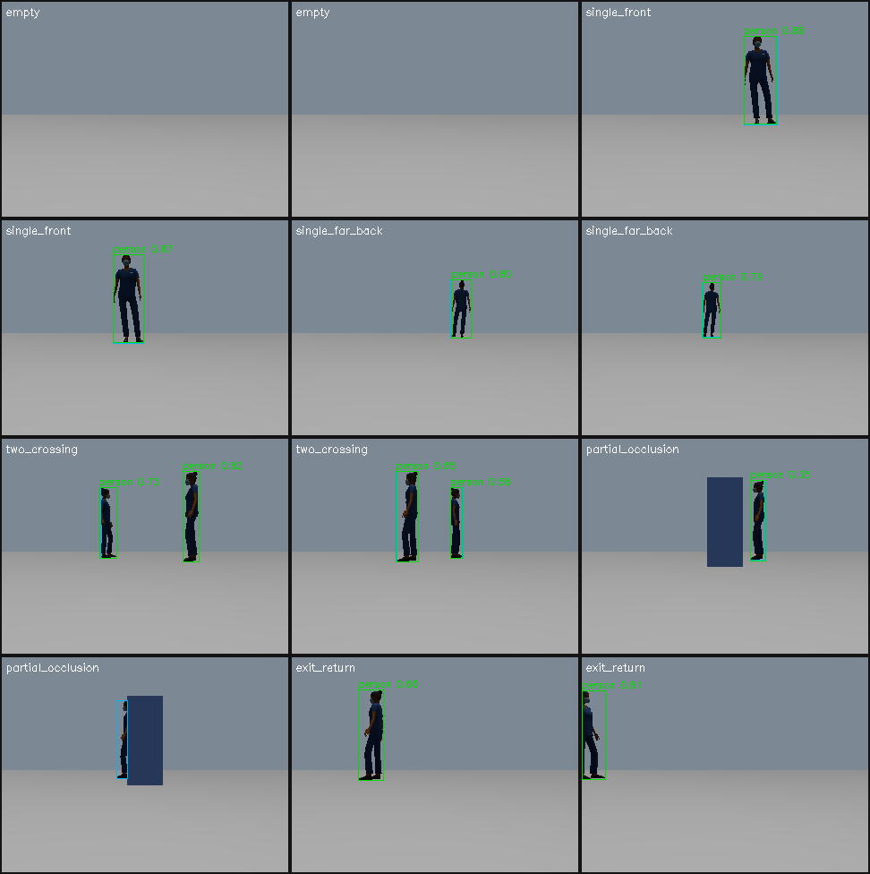

# TurtleBot 4 Person Detection and Following Research

Date: 2026-11-10. Technical research, an isolated simulation environment, and the Phase 2 baseline for 2D person detection are complete. All hardware is virtual, as requested by the user.

Server project: `/home/john/projects/turtlebot4_person_following`

Phase 1 covered nine open-source projects, built the environment, and passed nine sensor checks. Phase 2 implemented C++/ONNX CPU detection, standard ROS messages, independent ground truth, and a six-scenario evaluation with 360 frames. Overall recall was 78.26%: 100% for a nearby single person, 68.33% for two crossing people, and 40.91% under occlusion. 3D localisation, identity tracking, and autonomous following are not yet implemented.

## Reports

- [Phase 2 detection results, failure cases, and reproduction](docs/phase2_detection.md)
- [Industry research and nine open-source projects](docs/industry_research.md)
- [Technology comparison and selection](docs/technology_comparison.md)
- [Proposed system architecture](docs/system_architecture.md)
- [Virtual hardware and resource assessment](docs/hardware_assessment.md)
- [Phased implementation plan and proposed acceptance criteria](docs/implementation_plan.md)
- [Executed checks and test records](docs/test_report.md)

## Environment

Docker runs on the Ubuntu 26.04 host. The container uses Ubuntu 24.04, ROS 2 Jazzy, and Gazebo Harmonic. The pinned base-image digest is recorded in the Dockerfile and `evidence/ros_image.lock.json`; pinned source revisions and SHA-256 checksums are in `evidence/source_downloads.lock.json`. See `docs/test_report.md` for installed versions and execution results.

The offline base-image archive is stored on the server at `downloads/ros-jazzy-ros-base-noble.tar`; the Dockerfile builds the simulation environment. Phase 2 has compiled the yolo_ros overlay. The Nav2 source downloaded in Phase 1 remains a reference and has not replaced the apt-installed packages.

## Server commands

```bash
cd /home/john/projects/turtlebot4_person_following
# Host setup, already completed once: sudo bash scripts/bootstrap_host.sh

# Rebuild the environment; Ubuntu/ROS repositories are not a historical snapshot
bash scripts/build_env.sh

# Open a shell in the isolated environment
bash scripts/run_env.sh bash

# Run the stationary camera check, without person detection or motion commands
bash scripts/run_env.sh bash scripts/run_smoke.sh
```

By default, the runtime scripts disable external networking, map no physical devices, drop capabilities, and limit CPU and memory. The stationary check uses a fully local geometric world and the official robot model. Its geometric reference objects are not detected people. This check does not activate Nav2, SLAM, or autonomous following.

Phase 2 reuses the same image and builds pinned yolo_ros 5.0.0 and ONNX Runtime 1.20.0 in `research_ws/`. Input sources and hashes are recorded in `config/phase2_assets.lock.json`; large inputs and build outputs are excluded from Git. Run these commands on the Ubuntu server:

```bash
bash scripts/setup_perception.sh
bash scripts/run_person_suite.sh
bash scripts/analyze_person_suite.sh
```



The person mesh is OpenRobotics Scrubs, licensed under CC BY 4.0; see the Phase 2 report for attribution. Green boxes show predictions and blue boxes show independent ground truth. Crossing and occlusion produce substantial missed detections. The next phase is depth localisation, retaining these difficult cases for regression evaluation. Physical OAK depth accuracy, VPU performance, and following with a real mobile base remain **NOT VERIFIED**.
