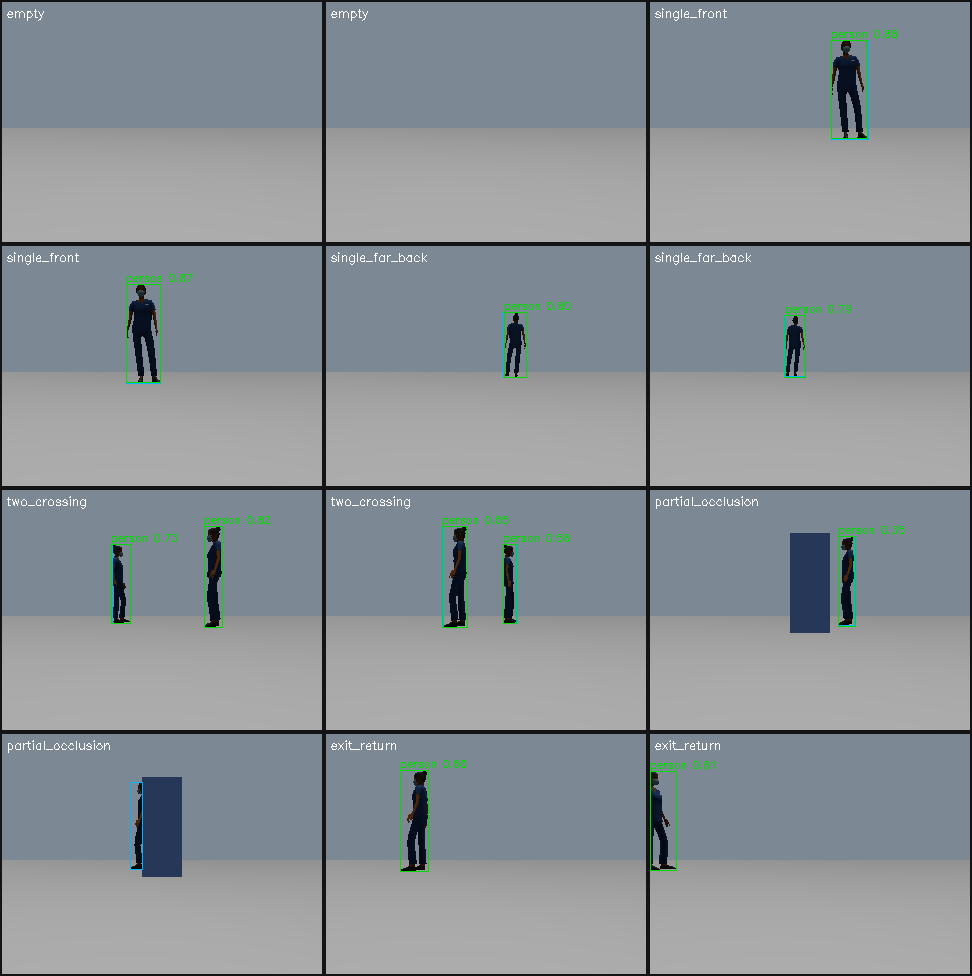
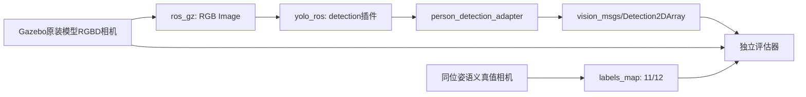

# 第二阶段：虚拟人物检测基线与评估

日期：2026-11-10（Europe/London）。状态：二维检测基线完成，困难场景可靠性不足；深度定位、身份跟踪和自主跟随尚未实现。

## 本阶段结论

在6个预设虚拟场景、360帧、322次可见人物标注中，YOLO26n检测得到252次正确匹配、70次漏检、0次误检，观测召回率78.26%。近距单人100%，远距另一朝向96.67%；两人交叉68.33%，遮挡40.91%。因此可继续用作深度定位的输入基线，但不能据此启用可靠人物跟随。

这些数值来自同一个人形网格的重复渲染，**不是322个不同的人，也不是实体OAK-D的测试结果**。当前背景简单、服装和体型单一，真实环境泛化仍为 **NOT VERIFIED**。



绿色为检测框，蓝色为独立真值框。人物资产：OpenRobotics [Scrubs，Fuel版本2](https://fuel.gazebosim.org/1.0/OpenRobotics/models/Scrubs)，[CC BY 4.0](https://creativecommons.org/licenses/by/4.0/)。资产配置未列原作者，按可获得的发布者与模型名署名。截图由本项目仿真生成。

## 固定软件、模型和资产

| 项目 | 实际使用版本/来源 |
|---|---|
| 基础环境 | 复用第一阶段`turtlebot4-research:jazzy`，无额外CUDA/PyTorch安装 |
| 感知实现 | 社区[yolo_ros](https://github.com/mgonzs13/yolo_ros/tree/94d2dd500cb26027ee9c019f4d3a02029ac615cc)，5.0.0，C++/pluginlib，MIT |
| 推理后端 | ONNX Runtime CPU 1.20.0，2线程，运行日志已确认provider=cpu |
| 下载客户端 | huggingface-hub-cpp请求tag1.1.5，解析提交`a894c86dc701b97b6627bc3986e542a72faa0fe3` |
| 模型 | 维护者配套仓库[unileon-robotics/YOLO26-ONNX](https://huggingface.co/unileon-robotics/YOLO26-ONNX)，revision `e046fc5125ee6b579f1801f0b6df68a60b949c42`，`yolo26n.onnx`，AGPL-3.0 |
| 模型实际输入 | FP32、`[1,3,480,640]`，元数据80个COCO类别；不是根据模型名称猜测640×640 |
| 模型SHA-256 | `4f44c33cea12d4b5785e5e7c0a20c13d0c62a77de607ce96a40d6036c7d7bbcf` |
| 人物模型 | OpenRobotics Scrubs，Fuel版本2，OBJ人形网格，约1MB下载；CC BY 4.0 |
| 资产ZIP SHA-256 | `1e4a5fbdfc8d02c688290d1c4e39430ec872bf3f976c5fc720cf6e98c740aea7` |

模型是社区提供的Ultralytics权重ONNX导出，不能描述成TurtleBot官方内置模型。代码MIT许可不改变模型权重的独立许可。完整来源、大小和hash见[输入锁](../config/phase2_assets.lock.json)及[构建溯源](../evidence/phase2/provenance.json)。大型输入和ROS overlay保存在服务器`downloads/`、`research_ws/`，不提交进Git。

## 实际数据链路



生产输出是`/perception/people/detections2d`，类型`vision_msgs/msg/Detection2DArray`，保留原图时间戳、像素坐标和类别置信度。只发布person类别，未设置跟踪ID。上游原始输出`/yolo/oakd/detections`使用`yolo_msgs`，由薄适配器转标准消息。

只激活`detection`插件，未激活tracking或3D插件。图像输入320×240，评估配置降为5Hz仿真时间；第一阶段原装模型30Hz配置没有被改写。URDF和world覆盖文件在项目的下载目录生成，不修改已安装驱动。

人物使用可控的刚性人形网格，通过Gazebo场景`set_pose`服务沿固定轨迹平移/旋转；不是骨骼步态动画，也没有真实人体碰撞行为。场景驱动器只能构造`person_1`、`person_2`名称，不给机器人底盘发布导航目标或速度。

## 独立标注与评分协议

- 使用Gazebo语义标签11/12区分两个人物实例；每个标签的可见像素最小外接矩形构成真值。完全遮挡或出视野、没有可见像素时，不生成该人的真值框。
- 真值传感器与RGBD相机共用光学安装位置、FOV和分辨率；按**完全相同的源时间戳**配对。无匹配时报告缺失并中止，不能用神经网络框代替标注。
- 检测器只订阅RGB。已进行[运行图检查](../evidence/phase2/graph_audit.json)：检测器/适配器没有订阅语义真值，图中没有机器人`cmd_vel`话题。
- 固定置信度阈值0.25、IoU≥0.50、按置信度排序一对一匹配。重复框计FP；没有预测消息的配对帧按空预测评分，并报告消息覆盖率。
- 每场景排除前2秒仿真启动，评价后续12秒、60帧。360帧的预测消息覆盖率全部为100%；这与人物召回率是两件事。
- 可见像素框会因遮挡而缩小。本报告的IoU规则同时评估定位范围；不能将结果直接等同于“是否发现一个人”或其他使用完整人体框的数据集指标。本阶段未计算mAP。

## 分场景结果

原始数据：[汇总JSON](../evidence/phase2/detection_report.json)，每场景`frames.json`保存时间戳、RGB文件hash、真值、预测和匹配。原始PNG全集在服务器`downloads/phase2/dataset/`，仓库保留固定索引的可视化样本与标注记录。

| 场景 | 帧 | 可见标注次数 | TP | FN | FP | 召回率 | 接收链路P95 |
|---|---:|---:|---:|---:|---:|---:|---:|
| 空场景 | 60 | 0 | 0 | 0 | 0 | 不适用 | 52.9ms |
| 约3.5m单人，yaw≈π | 60 | 60 | 60 | 0 | 0 | 100% | 54.9ms |
| 约5.5–6m单人，yaw=0 | 60 | 60 | 58 | 2 | 0 | 96.67% | 53.2ms |
| 两人相向平移交叉 | 60 | 120 | 82 | 38 | 0 | 68.33% | 56.2ms |
| 几何遮挡物遮挡人物 | 60 | 44 | 18 | 26 | 0 | 40.91% | 54.6ms |
| 离开视野后重新进入 | 60 | 38 | 34 | 4 | 0 | 89.47% | 53.7ms |
| 合计 | 360 | 322 | 252 | 70 | 0 | 78.26% | 见各场景 |

有98帧没有可见人物标注，其中未观测到误检。观测precision为100%，不能据此推断复杂背景下的误检概率。场景内按1秒时间块分层bootstrap（2000次、seed20261110），总体召回率的条件性95%百分位区间约69.84%–86.51%；它只描述本次场景内波动，不代表新人物或真实环境泛化，块长合理性也未做独立验证。

## 性能与对照

在线P95是评估订阅者从收到RGB到收到标准检测消息的墙钟时间，约53–56ms。它不包含相机曝光、传感器渲染到RGB到达评估节点之前的时间，因此**全链路采集延迟仍为NOT VERIFIED**。每场景总采集约30–32秒墙钟，包含启动、2秒仿真预热和排空；不能把配置中的5Hz当成实测墙钟实时帧率。

关闭Gazebo后，使用保存的同一批RGB做120张顺序ROS往返测试，排除5张预热，0超时：P50=35.42ms、P95=40.15ms、P99=41.80ms。平均往返时间倒数约27.97/s，只表示无渲染、单帧在途条件下的链路预算，**不是持续吞吐或在线相机FPS**。[原始记录](../evidence/phase2/offline_roundtrip.json)。

对同一360帧、同样640×480处理尺寸运行OpenCV默认HOG人体检测器，IoU≥0.5规则下TP=0、FP=122、FN=322。它并非没有产生人体候选：例如首帧HOG窗口比真值宽大，IoU约0.44，被严格规则计为FP+FN。未经框校准的默认HOG在本数据上定位范围不合适；不能从此实验推断所有HOG方法在一般场景中都失败。

HOG函数调用P50=44.59ms、P95=48.45ms；该计时不含ROS和resize，与YOLO的ROS往返计时范围不同，不能据此作公平的纯推理速度排名。[对照记录](../evidence/phase2/hog_baseline.json)。当前继续选YOLO26n作为后续阶段基线；没有证明它优于所有现代检测模型，DepthAI设备端路线因无实体VPU仍为NOT VERIFIED。

一次遮挡场景资源快照：约3.76个逻辑CPU、949MiB、181进程/线程、容器网络I/O为0；不是峰值或长时间稳定性结果。[快照](../evidence/phase2/resource_snapshot.json)。CPU接近4核限额，后续加导航前须重新做资源预算。

## 运行与复现

在服务器项目目录执行：

```bash
# 第一阶段镜像已存在；下载约10MB模型、1MB人物资产及固定源码，构建overlay
bash scripts/setup_perception.sh

# 六个案例；仅改变虚拟人物的场景姿态，机器人没有运动控制输入
bash scripts/run_person_suite.sh

# 同一数据的HOG对照、无渲染ROS往返、结果汇总
bash scripts/analyze_person_suite.sh
```

已实际执行下载校验、5个包编译、六场景采集、HOG对照、ROS往返和4个评分单元测试。固定输入可以复用；当前未额外进行另一台空机上的完整重建验证。完整PNG数据没有随Git分发，复现时需重新采集。

## 已遇到的问题与下一阶段边界

最初使用官方教程的Mingfei骨骼Actor：有真值相机时，渲染停在首帧并出现`Texture memory budget exceeded`。包围框与语义两种真值尝试都没产生可评分序列，失败日志保留于`attempt_bbox/`、`attempt_semantic/`，未计为模型漏检或成功样本。最终改用轻量Scrubs网格和语义可见像素真值；尚未证明该问题是Gazebo本身、驱动或特定资产中的哪一个单独因素导致。

下一阶段可接入实际深度图和TF做三维定位，但需要保留交叉与遮挡失败用例。人物身份、ID维持、遮挡后的目标重识别、跟随、Nav2、停止响应、实体OAK测距与VPU性能均为 **NOT VERIFIED**。本次没有启用自动跟随服务，也没有给机器人发布速度/导航动作。
