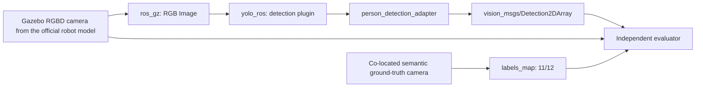

# Phase 2: Virtual Person Detection Baseline and Evaluation

Date: 2026-11-10 (Europe/London). Status: the 2D detection baseline is complete, with insufficient reliability in difficult scenes. Depth localisation, identity tracking, and autonomous following are not yet implemented.

## Findings

Across six predefined virtual scenes, 360 frames, and 322 visible person annotations, YOLO26n produced 252 correct matches, 70 missed detections, and zero false positives: observed recall 78.26%. Recall was 100% for a nearby single person and 96.67% at a farther distance/different orientation, but 68.33% for two crossing people and 40.91% under occlusion. This is a usable input baseline for depth-localisation work, but does not justify enabling reliable person following.

The figures come from repeated rendering of one human mesh. **They do not represent 322 different people or a physical OAK-D test.** Backgrounds are simple, with one clothing/body type. Real-world generalisation remains **NOT VERIFIED**.


Green boxes are detections; blue boxes are independent ground truth. Person asset: OpenRobotics [Scrubs, Fuel version 2](https://fuel.gazebosim.org/1.0/OpenRobotics/models/Scrubs), licensed under [CC BY 4.0](https://creativecommons.org/licenses/by/4.0/). The asset configuration does not name the original author, so attribution uses the available publisher and model name. Screenshots were generated by this project's simulation.

## Pinned software, model, and assets

| Item | Actual version/source |
|---|---|
| Base environment | Phase 1 `turtlebot4-research:jazzy`, with no additional CUDA/PyTorch installation |
| Perception implementation | Community [yolo_ros](https://github.com/mgonzs13/yolo_ros/tree/94d2dd500cb26027ee9c019f4d3a02029ac615cc), 5.0.0, C++/pluginlib, MIT |
| Inference backend | ONNX Runtime CPU 1.20.0, 2 threads; runtime logs confirm provider=cpu |
| Download client | huggingface-hub-cpp requested tag 1.1.5, resolved to commit `a894c86dc701b97b6627bc3986e542a72faa0fe3` |
| Model | Maintainer companion repository [unileon-robotics/YOLO26-ONNX](https://huggingface.co/unileon-robotics/YOLO26-ONNX), revision `e046fc5125ee6b579f1801f0b6df68a60b949c42`, `yolo26n.onnx`, AGPL-3.0 |
| Actual model input | FP32, `[1,3,480,640]`; metadata lists 80 COCO classes. Dimensions were inspected, not assumed to be 640×640 from the name |
| Model SHA-256 | `4f44c33cea12d4b5785e5e7c0a20c13d0c62a77de607ce96a40d6036c7d7bbcf` |
| Person asset | OpenRobotics Scrubs, Fuel version 2, OBJ human mesh, approximately 1MB download; CC BY 4.0 |
| Asset ZIP SHA-256 | `1e4a5fbdfc8d02c688290d1c4e39430ec872bf3f976c5fc720cf6e98c740aea7` |

The model is a community ONNX export of Ultralytics weights, not an official built-in TurtleBot model. The MIT code licence does not change the separate model-weight licence. Full sources, sizes, and hashes are in the [input lock](../config/phase2_assets.lock.json) and [build provenance](../evidence/phase2/provenance.json). Large inputs and the ROS overlay remain on the server in `downloads/` and `research_ws/`, outside Git.

## Implemented data path



The perception output is `/perception/people/detections2d`, type `vision_msgs/msg/Detection2DArray`, preserving source image timestamps, pixel coordinates, and class confidence. Only the person class is published, without tracking IDs. The native `/yolo/oakd/detections` output uses `yolo_msgs` and is converted through a thin adapter.

Only the `detection` plugin is active; tracking and 3D plugins are inactive. Input images are 320×240, with evaluation configured to 5Hz in simulation time. The Phase 1 original-model 30Hz configuration remains unchanged. URDF/world overrides are generated in the project's download directory rather than modifying installed drivers.

People are controllable rigid human meshes translated/rotated along fixed trajectories through Gazebo scene `set_pose` services. They have no skeletal gait animation or realistic human collision behaviour. The scene driver can construct only `person_1` and `person_2` names; it publishes no robot navigation goals or base velocities.

## Independent annotations and scoring protocol

- Gazebo semantic labels 11/12 distinguish the two person instances. The smallest rectangle enclosing each label's visible pixels defines its ground-truth box. Fully occluded/out-of-view people with no visible pixels receive no box.
- The ground-truth sensor shares optical placement, FOV, and resolution with the RGBD camera. Frames pair by **exactly equal source timestamps**. Missing matches are reported and abort evaluation; neural-network boxes never substitute for labels.
- The detector subscribes only to RGB. The [runtime graph audit](../evidence/phase2/graph_audit.json) confirms that detector/adapter nodes do not subscribe to semantic truth and that no robot `cmd_vel` topics appear.
- Confidence threshold 0.25 and IoU≥0.50 are fixed. Matching is one-to-one in confidence order. Duplicate boxes count as FP; paired frames without prediction messages are scored as empty predictions, and message coverage is reported.
- Each scene excludes the first 2 simulated seconds and evaluates the next 12 seconds, yielding 60 frames. Prediction-message coverage is 100% across all 360 frames; message coverage is distinct from person recall.
- Visible-pixel boxes shrink under occlusion. The IoU rule therefore evaluates localisation extent as well as detection. Results are not directly equivalent to person-presence detection or datasets using full-body boxes. mAP was not computed in this phase.

## Results by scenario

Raw data: [summary JSON](../evidence/phase2/detection_report.json). Each scenario's `frames.json` records timestamps, RGB file hashes, ground truth, predictions, and matches. Complete PNGs are on the server in `downloads/phase2/dataset/`; Git contains fixed-index visual samples and annotation records.

| Scenario | Frames | Visible annotations | TP | FN | FP | Recall | Reception-path P95 |
|---|---:|---:|---:|---:|---:|---:|---:|
| Empty scene | 60 | 0 | 0 | 0 | 0 | N/A | 52.9ms |
| Single person at approximately 3.5m, yaw≈π | 60 | 60 | 60 | 0 | 0 | 100% | 54.9ms |
| Single person at approximately 5.5–6m, yaw=0 | 60 | 60 | 58 | 2 | 0 | 96.67% | 53.2ms |
| Two people translating across each other | 60 | 120 | 82 | 38 | 0 | 68.33% | 56.2ms |
| Person occluded by a geometric obstacle | 60 | 44 | 18 | 26 | 0 | 40.91% | 54.6ms |
| Leaving and re-entering view | 60 | 38 | 34 | 4 | 0 | 89.47% | 53.7ms |
| Total | 360 | 322 | 252 | 70 | 0 | 78.26% | See individual scenes |

There were 98 frames without visible person annotations, with no observed false positives. Observed precision is 100%; this does not establish the false-positive probability in complex backgrounds. A bootstrap stratified by scene using 1-second time blocks (2000 repetitions, seed 20261110) gives a conditional 95% percentile interval for overall recall of approximately 69.84%–86.51%. It describes variability within these scenes, not generalisation to new people or real environments. Block-length suitability was not independently validated.

## Performance and comparison

Online P95 measures wall-clock time from RGB reception to standard detection reception at the evaluation subscriber, approximately 53–56ms. It excludes exposure, sensor rendering, and transport before RGB reaches that subscriber. **Full acquisition latency remains NOT VERIFIED.** Total capture took approximately 30–32 wall-clock seconds per scene, including startup, 2 simulated seconds of warm-up, and draining. The configured 5Hz is not a measured real-time wall-clock frame rate.

With Gazebo stopped, 120 saved RGB images were tested sequentially through the ROS path. Excluding 5 warm-up images, there were zero timeouts: P50=35.42ms, P95=40.15ms, P99=41.80ms. The reciprocal of mean round-trip time is approximately 27.97/s. This describes a budget without rendering and with one image in flight; **it is not sustained throughput or live camera FPS**. See the [raw record](../evidence/phase2/offline_roundtrip.json).

OpenCV's default HOG person detector was run on the same 360 frames at the same 640×480 processing size. Under the IoU≥0.5 rule it produced TP=0, FP=122, FN=322. It did produce person candidates: for example, the first-frame HOG window was larger than ground truth, with IoU approximately 0.44, and was scored FP+FN. The uncalibrated default HOG window extent was unsuitable for this dataset; this experiment does not establish that all HOG methods fail in general scenes.

HOG function-call P50=44.59ms and P95=48.45ms exclude ROS and resize. Their timing scope differs from the YOLO ROS round trip, so these figures do not provide a fair pure-inference speed ranking. See the [comparison record](../evidence/phase2/hog_baseline.json). YOLO26n remains the next-phase baseline; superiority over all modern detectors has not been established. Physical DepthAI inference remains NOT VERIFIED because no VPU is available.

One occlusion-scene resource snapshot showed approximately 3.76 logical CPUs, 949MiB, 181 processes/threads, and zero container network I/O. It is not a peak or long-term stability result. See the [snapshot](../evidence/phase2/resource_snapshot.json). CPU usage approaches the 4-core limit; reassess resources before adding navigation.

## Execution and reproduction

Run from the server project directory:

```bash
# Phase 1 image already exists; download the ~10MB model, ~1MB person asset,
# and pinned source, then build the overlay
bash scripts/setup_perception.sh

# Six cases; change only virtual person poses, with no robot motion-control input
bash scripts/run_person_suite.sh

# HOG comparison on the same data, ROS round trips without rendering, and summary
bash scripts/analyze_person_suite.sh
```

Download verification, five package builds, six-scene capture, HOG comparison, ROS round trips, and four scoring unit tests were actually executed. Pinned inputs can be reused, but a second full rebuild on a fresh machine has not been performed. Complete PNG data is not distributed through Git and must be captured again for reproduction.

## Encountered issues and next-phase boundaries

The initial Mingfei skeletal Actor from an official tutorial stalled on the first rendered frame when a ground-truth camera was present, logging `Texture memory budget exceeded`. Both bounding-box and semantic truth attempts failed to produce scoreable sequences. Logs are retained in `attempt_bbox/` and `attempt_semantic/`; these runs were counted neither as successful samples nor model false negatives. The final setup uses the lightweight Scrubs mesh and semantic visible-pixel truth. No single Gazebo, driver, or asset factor has been established as the root cause.

The next phase can use depth images and TF for 3D localisation while retaining crossing and occlusion failures for regression evaluation. Person identity, ID maintenance, target re-identification after occlusion, following, Nav2, stopping response, physical OAK ranging, and VPU performance remain **NOT VERIFIED**. No autonomous following service was enabled and no robot velocity/navigation actions were published.
