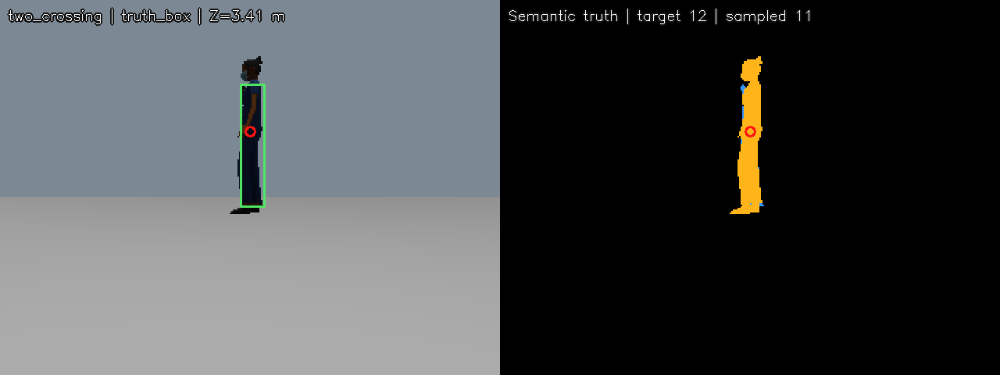

# Phase 3 Person Depth and Position Evaluation

Run date 2026-11-11. The Gazebo benchmark completed 14 scenarios and captured 990 frames. The live YOLO and depth pipeline returned 446 valid measurements for 622 visible person instances (71.70%). All 446 representative pixels landed on the matched person. Absolute forward-depth error against the visible torso reference had a P95 of 1.22 cm. The ideal-scene 3D torso position P95 was 18.18 cm, above the proposed 10 cm goal.

## Measurement method

The ROS node pairs the original YOLO image stamp with the same-stamp `32FC1` depth and `CameraInfo` messages. It requires compatible image frames, dimensions, and pinhole calibration. The simulation provides aligned images with zero distortion. ROS depth is optical-axis Z in metres. [ROS depth image convention](https://github.com/ros-infrastructure/rep/blob/master/rep-0118.rst) and [CameraInfo definition](https://github.com/ros2/common_interfaces/blob/jazzy/sensor_msgs/msg/CameraInfo.msg).

The torso candidate spans 25–75% of box width and 25–60% of height. The estimator discards non-finite values and depths outside 0.3–10 m. It requires 12 usable pixels and 30% valid coverage. It splits depth samples at gaps above 0.10 m, limits the spread around each mode, and scores connected components by central support. A component must cover at least 25% of the ROI. The estimate is rejected when a competing component has at least 67% of the winning score and its median differs by more than 0.20 m.

The winning component supplies a median Z and a representative pixel close to its spatial and depth medians. Pinhole back-projection gives optical-frame XYZ, and its norm gives straight-line camera range. The prototype publishes those values, the representative pixel, source stamp, and per-box validity on `/perception/people/depth_estimates` as a versioned JSON record in `std_msgs/String`. Phase 3 measures positions in the camera frame.

## Independent reference and scoring

- The evaluator records Gazebo model and camera-link poses from `/world/person_eval/pose/info`. It builds the optical camera pose from the scene poses and derives focal length from the simulator's configured field of view. The nearest accepted pose differed from the image stamp by at most 8 ms in this run. The configured limit was 25 ms. [Gazebo Harmonic SceneBroadcaster source](https://github.com/gazebosim/gz-sim/blob/gz-sim8/src/systems/scene_broadcaster/SceneBroadcaster.cc)
- An analytic ray/plane intersection gives the plane reference. A CPU rasterizer intersects image rays with the transformed Scrubs visual mesh to obtain independent person-surface depth. The aligned semantic camera identifies visible surfaces and distinguishes the two meshes and the geometric blocker. The minimum projection coverage was 99.79% of visible labelled person pixels. The evaluation graph listed only the evaluator as a semantic-label subscriber in all 14 cases.
- The torso reference is the componentwise median of visible surface intersections between 45% and 75% of the mesh's local height. It requires at least 12 visible torso pixels and 90% mesh projection coverage. The evaluator also compares the estimated point with the intersection along its selected pixel ray. The torso metric includes the error from choosing the representative point, so accurate Z can coexist with a sizeable vertical or lateral position error.
- Detections are matched to the visible semantic boxes at IoU ≥ 0.50, one to one in confidence order. A valid output counts when the matched box produces a numeric distance. Correct-surface coverage additionally requires the representative pixel to carry the matched person's semantic label. Both rates use all visible person instances as the denominator. Errors describe numeric outputs with a reference. For the truth-box control, the evaluator feeds the visible semantic box to the same estimator. A second control takes the simple ROI median on the same input as the live method.

## Plane calibration

Each nominal distance supplied 110 annotated frames. The centre of the orange plate supplied a 24 × 24 pixel sample. Reported reference Z accounts for the actual camera and front-face poses.

| Nominal distance | Reference Z | Frames with depth | Valid centre pixels | Absolute Z P95 | Frame error SD | RGB / depth plate IoU |
|---|---:|---:|---:|---:|---:|---:|
| 1 m | 1.00810 m | 109/110 | 99.09% | 0.39 µm | 0.00 µm | 1.000 / 0.981 |
| 2 m | 2.00811 m | 109/110 | 99.09% | 0.97 µm | 0.00 µm | 1.000 / 0.985 |
| 3 m | 3.00812 m | 109/110 | 99.09% | 1.07 µm | 0.00 µm | 1.000 / 0.966 |

The signed mean errors were positive and equal to the listed absolute errors in these static captures. The plate masks came from the RGB colour and a ±3 cm depth band around the geometric plane, compared with semantic label 30. This measures numerical agreement and registration in the virtual setup.

## Person results

Each case contributed 60 frames. Depth and position errors below use the visible torso reference.

| Scenario | Visible instances | Matched YOLO boxes | Valid output rate | Wrong surface | Absolute Z P95 | 3D P95 |
|---|---:|---:|---:|---:|---:|---:|
| Person at 1 m | 60 | 0 | 0/60 (0.0%) | 0 | — | — |
| Person at 2 m | 60 | 60 | 57/60 (95.0%) | 0 | 0.30 cm | 17.26 cm |
| Person at 3 m | 60 | 60 | 58/60 (96.7%) | 0 | 0.30 cm | 6.86 cm |
| Person at 2 m, off-axis | 60 | 60 | 58/60 (96.7%) | 0 | 0.40 cm | 18.18 cm |
| Torso blocker sweep | 60 | 42 | 37/60 (61.7%) | 0 | 0.54 cm | 9.16 cm |
| Empty | 0 | 0 | — | 0 | — | — |
| Moving single front | 60 | 60 | 57/60 (95.0%) | 0 | 0.39 cm | 8.49 cm |
| Far single, facing away | 60 | 58 | 56/60 (93.3%) | 0 | 0.86 cm | 7.36 cm |
| Two people crossing | 120 | 82 | 76/120 (63.3%) | 0 | 1.24 cm | 10.21 cm |
| Partial occlusion | 44 | 18 | 16/44 (36.4%) | 0 | 1.10 cm | 10.07 cm |
| Exit and return | 38 | 34 | 31/38 (81.6%) | 0 | 4.93 cm | 9.56 cm |
| **Overall** | **622** | **474** | **446/622 (71.70%)** | **0** | **1.22 cm** | **18.18 cm** |

Across the accepted results, Z bias was −0.32 cm and MAE was 0.55 cm. Against the intersection on the selected pixel ray, Z MAE was 1.00 cm and P95 was 1.90 cm. Of the 176 instances without a numeric output, 148 lacked a matching detection, 26 had a matching box with no range message, and two had insufficient depth. The evaluator received a range message at 628 of 660 person/empty frame stamps, including messages with no detected person.

The four nominal 1–3 m cases produced 173/240 estimates (72.08%), with Z P95 of 0.40 cm and 3D P95 of 18.18 cm. The torso 3D goal was missed at 2 m on-axis and off-axis. At 1 m the visible silhouette is cropped by the camera field of view and YOLO produced zero person boxes in 60 frames. Feeding the truth box gave 60/60 correct-surface outputs there. Across the complete person benchmark the truth-box control returned 599/622 numbers, of which 597 sampled the intended person.

## Occlusion and wrong measurements

An instance is counted as torso-occluded when the geometric blocker or the other person covers at least 5% of its projected torso. This yielded 64 visible instances, including 38 in the torso blocker sweep, 20 in partial occlusion, and six in two-person crossing.

| Method | Numeric output | Correct surface | Wrong person | Blocker / background |
|---|---:|---:|---:|---:|
| Live YOLO + guarded depth | 20/64 (31.25%) | 20 | 0 | 0 / 0 |
| Same estimator with truth boxes | 53/64 (82.81%) | 51 | 2 | 0 / 0 |

All 20 live outputs came from the torso blocker sweep. The other 44 occluded instances had no matched YOLO box. The accepted outputs had absolute Z P95 of 1.37 cm and torso position P95 of 11.95 cm. Two position errors exceeded 10 cm, and zero Z errors exceeded 10 cm.

The truth-box control picked the foreground person at simulated times 7.2 s and 7.4 s in the crossing scene. It returned 3.409 m for rear target label 12 while the selected pixel was on foreground label 11. The rear target's torso was about 97% obstructed with seven visible torso pixels. These two outcomes count as wrong-person measurements. They fall below the minimum visible support for a torso error reference.



On the 20 occluded instances with a matched box and comparable inputs, both the guarded estimator and the simple median produced 20 numbers on the intended person. The guarded Z P95 was 1.37 cm and the simple median's was 1.84 cm. Their 3D P95 values were 11.95 cm and 9.14 cm respectively. On all 438 comparable matched instances, each method emitted 437 numbers with zero wrong-surface selections. The benchmark therefore provides coverage and error evidence for both estimators, with limited evidence about wrong-surface rejection.

## Reproduction and scope

The run reused the installed Ubuntu 24.04, ROS 2 Jazzy and Gazebo Harmonic environment on the Ubuntu VMware host, the pinned CPU YOLO26n model, and OpenRobotics Scrubs. After installing Phases 1–2, run these commands in the repository checkout.

```bash
bash scripts/run_depth_suite.sh
bash scripts/run_env.sh python3 scripts/evaluate_depth_suite.py
bash scripts/run_env.sh python3 -m pytest -q tests
```

Nine unit tests passed. The Phase 2 single-front regression produced 60/60 matches, zero false positives, and full detection-message coverage. The independent evaluator checked that the live outputs agreed with a replay on the same available inputs. The graph reported zero velocity topics in all captures. The validation covers camera-relative ranging in simulation and stops at Phase 3. It uses correlated rendered frames from one synthetic human mesh. Physical-camera error and base/map-frame localisation require separate measurements.

- [Structured results](../evidence/phase3/depth_report.json)
- [Per-frame measurements and truth-box comparisons](../evidence/phase3/measurements.jsonl)
- [Capture log](../evidence/phase3/capture.log), [evaluation log](../evidence/phase3/evaluation.log), [unit tests](../evidence/phase3/unit_tests.log), and [Phase 2 regression](../evidence/phase3/phase2_regression.log)
- [Environment, tested source hashes, and raw capture hashes](../evidence/phase3/provenance.json)

The raw captures are generated under `downloads/phase3/capture`. Full input arrays remain on the simulation host. The committed logs and scored rows contain the results needed to audit the published metrics.
