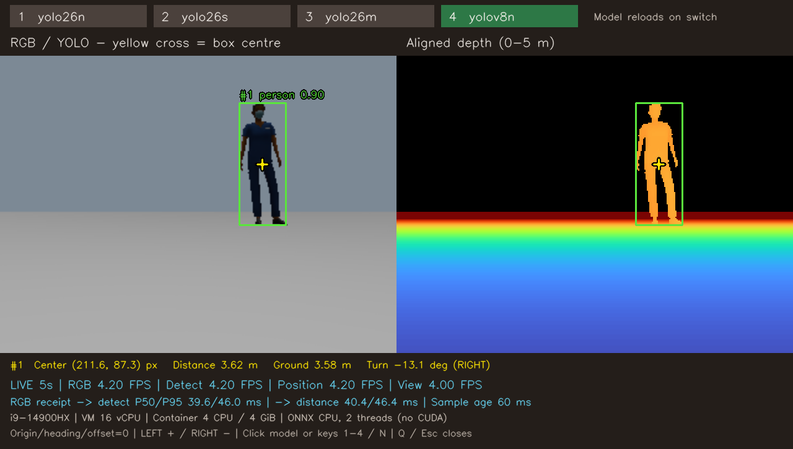
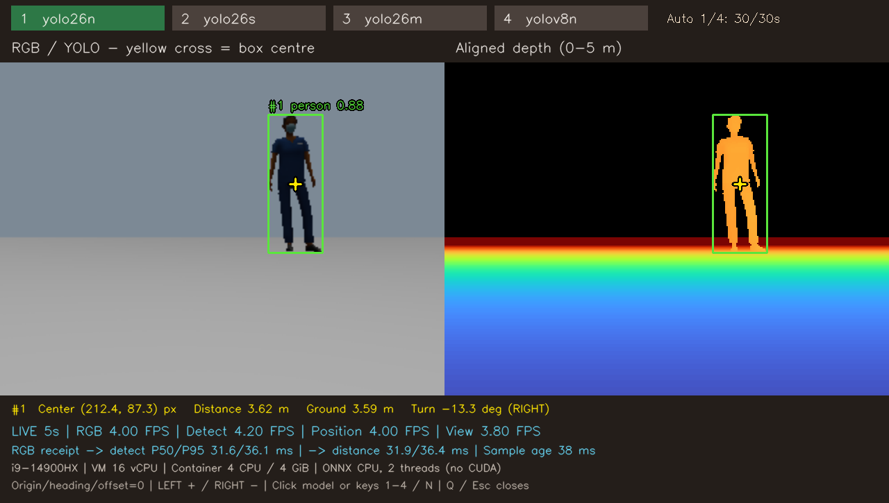
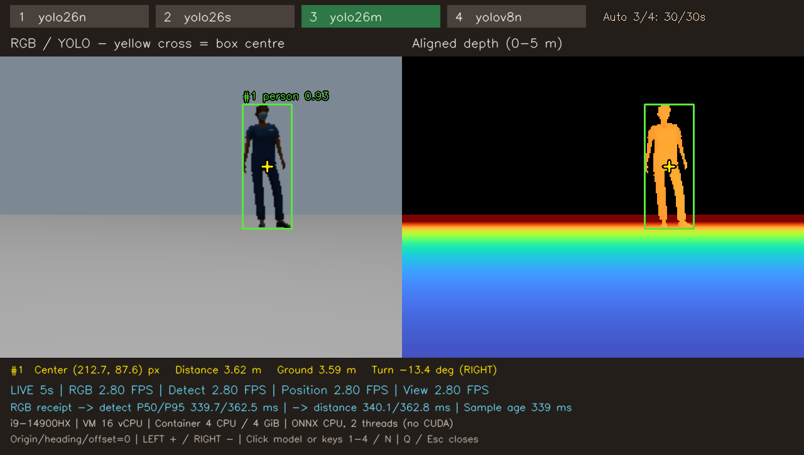

# YOLO Model Comparison from robotcv2

Wenhao Fan wrote the original comparison. The sections and screenshots below come from the robotcv2 README at commit `aaff8a0`. The first-person text, hardware figures, and interactive preview controls refer to his test setup. [Original report](https://github.com/Intelligent-Robotics-project-group-7/Intelligent-Robotics-project-group-7/blob/aaff8a0d078094c6f85deed78a4617647f4c262e/README.md#my-work-and-the-model-speedaccuracy-trade-off)

## My work and the model speed/accuracy trade-off

This revision builds on the `robot-CV` YOLO26n baseline at commit [23d4ef3](https://github.com/Intelligent-Robotics-project-group-7/Intelligent-Robotics-project-group-7/commit/23d4ef304fd5c5dd1f9569ccbeaa90554fce6038), adding selectable models and person-centre distance and bearing outputs. The improvement figures in this section refer to that specific baseline version.

I tested YOLO26n, YOLO26s, YOLO26m and YOLOv8n through the same detection pipeline. On the same 360 synthetic frames containing 322 visible person annotations, recall increased from 78.26% with the `23d4ef3` baseline to 95.03% with YOLO26s or YOLO26m; YOLOv8n reached 93.17%. Compared with `23d4ef3`, the added model options improve measured detection coverage and allow a choice between accuracy and processing speed. The larger models required more processing time, and YOLO26s and YOLO26m achieved the same recall, so a larger model did not automatically improve every accuracy measure. These results describe this synthetic benchmark, rather than a demonstrated improvement on physical robots.

For my current accuracy-focused experiments, I have chosen YOLO26m, the largest model in the current set. This helps me investigate detection quality, but it may reduce the rate at which new person positions become available. The robot has a limited computing budget, so the final model choice needs to balance accuracy, processing speed and the resources needed by the rest of the system.

This trade-off matters especially when the person is moving. Even a correctly detected position can already be out of date when processing finishes. If inference or message queues fall behind, position updates may arrive too slowly to describe the person's current location. High accuracy on individual images therefore does not by itself establish good performance for person following.

I have added live FPS and receipt-latency counters to the preview so that I can switch models and observe their behaviour with a moving virtual person. The planning table below uses estimates; a complete four-model sustained live benchmark has not been completed for that table. My next step is to evaluate end-to-end latency, position update rate and observation age on the intended robot hardware. Delayed updates during real following remain a concern to test, rather than a failure already demonstrated on the physical robot.

## My computer and expected live performance

The development computer configuration was read locally on 11 November 2026:

| Component | Configuration |
|---|---|
| Host CPU | Intel Core i9-14900HX, 24 cores / 32 logical processors |
| Installed RAM | 32 GiB, two 16 GiB modules |
| Host GPU | NVIDIA GeForce RTX 4060 Laptop GPU, approximately 8 GiB VRAM (8188 MiB reported) |
| Host OS | Windows 11 Pro, build 26200 |
| Ubuntu VM | 16 logical vCPUs and 15946 MiB visible RAM (about 15.6 GiB) |
| Test container limit | 4 CPUs and 4 GiB RAM, shared by simulation, detection, ranging and preview |
| Model execution | ONNX Runtime CPU, 2 inference threads; no CUDA inference or GPU passthrough |
| Camera configuration | 320x240 RGB/depth, 5 frames per simulated second; software rendering |

The host has an RTX GPU, but this pipeline currently performs inference and simulation rendering on the CPU. These resource limits are part of the current development setup and do not describe the laptop's maximum available performance or the Raspberry Pi/OAK hardware on a physical robot.

### Estimated performance, not full benchmark results

The following are approximate planning ranges informed by earlier CPU replay results and brief/partial live checks. They are **estimates**, not a completed, controlled four-model live benchmark, confidence intervals or guaranteed limits. Actual rates and delays vary with rendering load, virtual-machine scheduling, scene complexity and other work on the computer.

| Model | Estimated detection update rate, wall-clock FPS | Estimated RGB-receipt-to-detection delay |
|---|---:|---:|
| YOLO26n | about 3.5-5 FPS | about 25-60 ms |
| YOLO26s | about 3-4.5 FPS | about 80-160 ms |
| YOLO26m | about 2-3.5 FPS | about 250-600 ms |
| YOLOv8n | about 3.5-5 FPS | about 35-80 ms |

FPS here means expected detection-result updates per real second in this simulated pipeline. It is not maximum model throughput and is not calculated as `1000 / latency_ms`. The configured 5 Hz camera rate uses simulation time; when rendering runs slower than real time, the actual input rate is lower. Rendering and inference also compete for the container's CPU allocation. Similar FPS values can therefore hide quite different per-frame processing delays.

The delay starts when the preview receives the RGB message and ends when it receives the detection for the same source timestamp. It excludes sensor acquisition, rendering and any transport before RGB reaches that subscriber. It is not pure neural-network inference time or a complete camera-to-robot-control latency.

### Interactive performance display

The local preview tools in `treerobot-CVothers` let me click the model buttons or press `1` to `4` to select YOLO26n, YOLO26s, YOLO26m or YOLOv8n. `N` selects the next model; `Q` or Esc closes the preview. Switching reloads the detector and clears old image/result caches before displaying the new model's data.

The screen shows **actual live measurements over a rolling five-second wall-clock window**, separately from the estimates above:

- **RGB FPS:** received RGB messages per second.
- **Detect FPS:** detection-array messages per second, including arrays with no person.
- **Position FPS:** frames per second with at least one valid distance point; it is not a persistent tracked-person rate.
- **View FPS:** new same-frame RGB/depth/detection/distance combinations handed to the preview per second.
- **P50/P95 latency:** same-source-timestamp RGB receipt to detection or distance-result receipt. Invalid callback-order pairs are counted separately and excluded from these latency percentiles.
- **Sample age:** time from RGB receipt to preparing that displayed sample, not the physical display's scan-out delay.

The virtual person moves repeatedly from side to side while the robot remains stationary. This helps make delayed updates visible, but it does not test real walking, identity tracking or autonomous following. Test scripts, raw performance records and preview code remain in `treerobot-CVothers`.

## Original preview screenshots

YOLOv8n preview with the selected model highlighted and live person-centre measurements.

YOLO26n baseline preview, showing the same distance and bearing outputs with live performance counters.

YOLO26m preview, showing the larger model's live update rate and receipt latency in the moving-person scene.

These are actual preview snapshots with rolling five-second measurements, captured at different moments. Their displayed values are separate from the estimated performance ranges above and do not form a controlled same-frame model comparison. The YOLO26n and YOLO26m images were saved during a partial timed run; the full four-model timed comparison was not completed. The original detection contact sheet remains in `evidence/phase2/detection_contact_sheet.png`.
