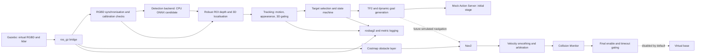
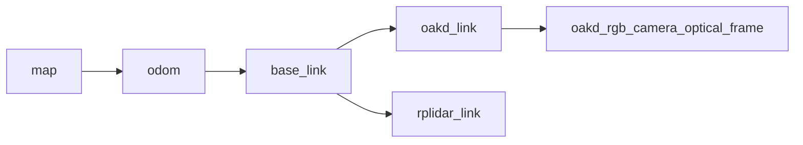

# Proposed System Architecture (Design, Not an Implemented System)

Original design date 2026-11-10. The simulation implements sensor validation, 2D detection, camera-relative depth and explicit person-track selection. The diagram extends that setup with planned navigation.

Phase 2 runs `yolo_ros` and publishes `/perception/people/detections2d` (`vision_msgs/Detection2DArray`). Phase 3 pairs those messages with same-stamp depth and camera calibration, then publishes `/perception/people/depth_estimates` with camera-frame positions. The evaluator is the sole subscriber to semantic truth. See the [Phase 3 report](phase3_depth.md) for the measured pipeline and its limits.

The optional Phase 4 tracker subscribes to detections and same-stamp depth estimates. It publishes session-local tracks and an explicitly selected target on `/perception/people/tracks`. [Phase 4 tracking report](phase4_tracking.md)

## Node relationships and module boundaries



Gazebo ground truth is sent independently to the evaluator and must not enter the evaluated detector/tracker. Simulated human models must remain distinct from person detections; renaming model truth as visual recognition is invalid.

## Draft interfaces

| Input/output | Message/interface | Constraints |
|---|---|---|
| RGB, Depth | sensor_msgs/Image | Preserve source stamp, frame, encoding, and step; do not assume all depth is in millimetres |
| Intrinsics | sensor_msgs/CameraInfo | Must match image dimensions, cropping, and optical frame |
| /scan | sensor_msgs/LaserScan | Ground-level obstacle avoidance/localisation; no direct person identity |
| /tf, /tf_static | tf2_msgs/TFMessage | One authoritative publisher per transform |
| /clock | rosgraph_msgs/Clock | All simulation processing nodes use use_sim_time=true |
| /perception/detections2d | vision_msgs/Detection2DArray | Class, confidence, bbox, source stamp; model provenance may be retained |
| /perception/detections3d | vision_msgs/Detection3DArray | 3D bbox/position and explicit frame; populate covariance according to the installed message definition |
| /tracking/tracks | Proposed minimal TrackedPersonArray | Customise only where standard messages cannot express track velocity, lifetime, and identity uncertainty |
| /target/pose | geometry_msgs/PoseStamped | Only a valid, locked target; never fabricate a fresh stamp without a source observation |
| /target/state | Proposed structured status message | session_id, track_id, state, age, reason; do not control through string parsing |
| /target/select | Proposed SelectTarget service | Explicitly select session/ID and verify the track exists; selection does not enable motion |
| /target/clear | std_srvs/Trigger | Clear the lock and withdraw the target |
| /navigate_to_pose | nav2_msgs/action/NavigateToPose | Initially implemented by a Mock server to validate feedback/cancellation/updates |
| Dedicated following | nav2_msgs/action/FollowObject, if available | Verify against actual Jazzy packages before depending on it |
| /diagnostics | diagnostic_msgs/DiagnosticArray | Frame rates, latency, valid-depth fraction, TF and target timeouts |

The generic detection topic names in this draft are proposed interfaces. Phase 2 currently uses `/perception/people/detections2d` as stated above.

Proposed track structure: Header, session_id, uint64 track_id, PoseWithCovariance, TwistWithCovariance, 2D bbox, class/confidence, last_observed stamp, lifecycle state, and observing sensors. Keep appearance vectors inside the tracker; add a debug interface only if needed rather than broadcasting them to navigation.

## RGB-D and time handling

1. Build intrinsics from received CameraInfo and message encodings; verify RGB/depth alignment. If unaligned, reproject with intrinsics and extrinsics. Equal image dimensions do not prove alignment.
2. Start with corresponding stamps from the same simulated RGBD sensor. Use message_filters approximate synchronisation where stamps differ. An initial 33ms window is proposed and awaits acceptance testing.
3. Map model letterbox/resize coordinates back to original RGB pixels, then to aligned depth ROIs. Reject NaN, Inf, zero, and out-of-range values. Use a person mask or inner torso ROI with median/robust statistics and a minimum valid-pixel fraction.
4. Optical back-projection: `X=(u-cx)Z/fx, Y=(v-cy)Z/fy, Z=depth`. Account for distortion and whether P/K corresponds to the current image representation; rectified intrinsics cannot be applied blindly to an unrectified image.
5. Measure processing delay with a monotonic wall clock; use ROS simulation time for observation relationships. When simulation runs slower than real time, a sim-time difference does not represent the user's actual waiting time.

## Frames and filtering



Use names from the actual TF tree; some models use base_footprint. Optical axes are right/down/forward, while base axes are typically forward/left/up. Manual XYZ swapping is not a substitute for TF. Query transforms at the observation stamp; do not hide synchronisation errors by silently using the latest TF. Filter short-term person tracks in continuous odom coordinates and transform goals to map when required. Localisation jumps must invalidate or reinitialise the target.

Derive observation covariance by propagating depth noise and pixel error; do not invent calibrated noise parameters in Phase 1. A constant-velocity Kalman state `[x,y,vx,vy]` can use Mahalanobis gating with appearance/bbox evidence. Increase uncertainty for ambiguous candidates or poor depth quality.

## Target management and navigation

States: DISABLED → WAIT_TARGET → CONFIRMED → FOLLOWING, after separate enablement → LOST_STOP/FAULT. Restart, backward clock jumps, invalid TF, and sensor timeouts withdraw navigation goals and maintain a stopped state. Do not automatically lock onto another person.

The goal cannot be the person's centre. Retain a designed stand-off distance along the robot–target line, then check costmap free space, global reachability, local costs, and goal changes. An initial update rate of 2–5Hz with distance/time filtering is proposed. Final frequency depends on latency and oscillation testing; it is not verified performance.

Initially run only a Mock Action Server to test goal updates, timeout cancellation, competing actions, and rejection handling. Later use Nav2 dynamic-following behaviour trees or a verified Following Server. Following and other navigation controllers must not compete for base velocity.

## Lifecycle, recovery, and protection chain

During configure, perception and target management validate models, topics, calibration, and TF before entering inactive. Activation requires explicit action. On failure, publish diagnostics and withdraw goals. Camera/model restart creates a new session without inheriting old track IDs.

Initial design values, not measurements: simulated speed limit 0.10m/s and new-observation timeout 0.5s. An independent wall-clock watchdog checks processing liveness so paused simulation/ROS time cannot keep stale data valid. Coordinate sensor and Collision Monitor timeouts; do not set them to zero to disable required stopping behaviour. Adjust after fault injection.

The runtime container has no external network, uses localhost ROS discovery and isolated Domain 84, maps no physical USB/devices, and starts no autonomous following service. Software Collision Monitor does not establish hardware-level safety.

## Proposed directory layout

```text
turtlebot4_person_following/
  docs/                 Research, selection, design, hardware, plan, test records
  scripts/              Build, runtime, environment and sensor checks
  config/               Model, synchronisation and protection parameters
  worlds/               Stationary test world without a Fuel dependency
  src/                  Future ROS packages; no placeholders presented as features
  evidence/             Pinned revisions, package versions, logs, measurement JSON
  downloads/            Server image and source caches
  Dockerfile
```

Sources: interface and model information comes from the official TurtleBot bridge source, Nav2 Jazzy documentation, and the pinned records in `industry_research.md`. Specific node names, states, thresholds, and module boundaries are project design recommendations and are not yet fully implemented.
