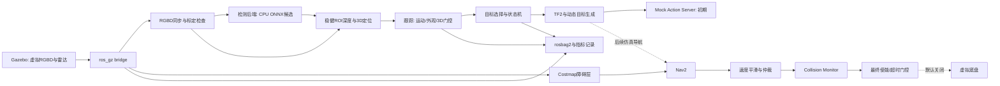
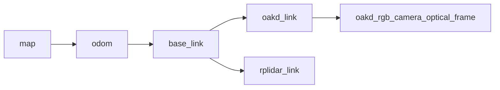

# 推荐系统架构（设计稿，非已实现系统）

日期：2026-11-10。当前完成仿真基础、传感器验证和二维人物检测链路；以下完整跟踪/三维定位/导航架构仍是设计。

第二阶段已运行`yolo_ros` detection插件与`person_detection_adapter`，输出`/perception/people/detections2d`（vision_msgs/Detection2DArray）。独立语义真值只进入评估器，不进入推理节点。未启用跟踪、3D、导航或跟随。实际节点和评估边界见[第二阶段报告](phase2_detection.md)。

## 节点关系与模块边界



Gazebo真值独立输出给评估器，不能进入被测检测器/跟踪器。模拟人体模型与“person”检测结果必须保持分离，不能把模型真值改名当作视觉识别。

## 接口草案

| 输入/输出 | 消息/接口 | 约束 |
|---|---|---|
| RGB、Depth | sensor_msgs/Image | 保留源stamp、frame、encoding、step；禁止默认把所有深度当毫米 |
| 内参 | sensor_msgs/CameraInfo | 与当前图像尺寸、裁剪和光学frame一致 |
| /scan | sensor_msgs/LaserScan | 地面避障/定位，不直接提供人物身份 |
| /tf、/tf_static | tf2_msgs/TFMessage | 每条变换只有一个权威发布者 |
| /clock | rosgraph_msgs/Clock | 所有仿真处理节点 use_sim_time=true |
| /perception/detections2d | vision_msgs/Detection2DArray | 类别、置信度、bbox、源stamp；可保留模型来源 |
| /perception/detections3d | vision_msgs/Detection3DArray | 3D bbox/位置，frame明确，协方差按已安装消息定义填充 |
| /tracking/tracks | 拟定义最小TrackedPersonArray | 标准消息不能完整承载轨迹速度、寿命和身份不确定度时才自定义 |
| /target/pose | geometry_msgs/PoseStamped | 仅输出当前有效、已锁定目标，禁止无来源的新鲜stamp |
| /target/state | 结构化状态消息，草案 | session_id、track_id、状态、age、reason，不用字符串解析控制 |
| /target/select | 拟定义SelectTarget service | 显式选择session/ID并验证轨迹存在，不顺便使能运动 |
| /target/clear | std_srvs/Trigger | 清除锁定并撤销目标 |
| /navigate_to_pose | nav2_msgs/action/NavigateToPose | 初期由Mock server实现，验证反馈/取消/更新 |
| 专用跟随 | nav2_msgs/action/FollowObject（存在时） | 以实际Jazzy包核实接口；未确认前不依赖 |
| /diagnostics | diagnostic_msgs/DiagnosticArray | 帧率、延迟、深度有效比例、TF和目标超时 |

轨迹结构草案：Header、session_id、uint64 track_id、PoseWithCovariance、TwistWithCovariance、2D bbox、类别/置信度、last_observed stamp、生命周期、观测传感器。外观向量保留在跟踪器内部，按需加调试接口，不广播给导航。

## RGB-D和时间处理

1. 从真实收到的CameraInfo与消息编码建立内参；检查RGB/Depth是否对齐。未对齐时使用外参、内参重投影，不能仅因尺寸相同就认为对齐。
2. 首先使用同一模拟RGBD传感器的对应stamp；存在差异时使用message_filters近似同步。建议同步窗口初值33ms，属于待验收设计参数。
3. 模型letterbox/resize映射回原RGB坐标后，再转对齐深度ROI。剔除NaN、Inf、0和超量程数据；使用人体掩码或躯干内部ROI的中位数/稳健统计，设置有效像素比例门槛。
4. 光学坐标反投影：`X=(u-cx)Z/fx, Y=(v-cy)Z/fy, Z=depth`。需要考虑畸变、P/K矩阵对应的图像状态，不能对未校正原图直接套用校正内参。
5. 处理延迟使用单调墙钟测量；ROS仿真时间用于观测关系。仿真慢于实时的时候不能把sim-time差当成人类实际等待时间。

## 坐标与滤波



名称必须以实际TF树为准，部分模型使用base_footprint。光学轴为右/下/前，底盘通常为前/左/上，不能手工交换XYZ替代TF。用观测stamp查询变换；不以“最新TF”悄悄消除同步错误。瞬时人员轨迹在连续的odom中滤波，导航目标必要时转map；定位跳变要使目标失效或重新初始化。

相机观测协方差由深度噪声与像素误差传播得到；第一步不伪造标定噪声参数。可采用恒速Kalman状态`[x,y,vx,vy]`，用马氏距离门控并融合外观/bbox；多候选或深度质量差时应增加不确定度。

## 目标管理与导航

状态：DISABLED → WAIT_TARGET → CONFIRMED → FOLLOWING（单独使能后）→ LOST_STOP/FAULT。重启、时间回退、TF失效、传感器超时会撤销导航目标并保持停止；默认不重新锁定另一人。

目标点不能等同于人体中心。沿机器人与目标连线保留设计跟随距离，再检查costmap自由空间、全局可达性、局部代价和目标变化量。初始建议目标更新2–5Hz且做距离/时间阈值过滤；最终频率由延迟和抖动测试决定，不是已验证性能。

初期只运行Mock Action Server，验证目标更新、超时取消、多个action竞争以及拒绝结果。后续使用Nav2动态跟随行为树或经核实的Following Server；跟随控制器与其他导航不得同时争夺底盘速度。

## 生命周期、恢复和保护链

感知与目标管理在configure阶段验证模型、话题、相机标定和TF，再进入inactive；activate需要显式操作。失败时输出诊断并撤销目标。相机/模型重启会创建新session，不继承旧track ID。

初始设计值（非实测）：仿真低速上限0.10m/s；目标新观测超时0.5s；独立保护用墙钟检查处理进程存活，避免仿真/ROS时钟暂停时继续认为数据有效。传感器与Collision Monitor的超时应协调配置，不能设置0以取消必要停机机制。后续进行故障注入后再调整。

当前容器运行时无外部网络，ROS只在localhost发现，独立Domain 84；不映射实体USB或设备，不启动自动跟随服务。软件Collision Monitor不提供硬件级安全证明。

## 推荐目录

```text
turtlebot4_person_following/
  docs/                 调研、选型、设计、硬件、计划、实测记录
  scripts/              构建、运行、环境/传感器检查
  config/               后续模型/同步/安全参数
  worlds/               不依赖Fuel的静止测试世界
  src/                  后续ROS包，当前不放占位功能伪装完成
  evidence/             固定提交、包版本、日志、测量JSON
  downloads/            服务器镜像/源码缓存
  Dockerfile
```

来源：接口和模型信息来自TurtleBot官方桥接源码、Nav2 Jazzy文档与 `industry_research.md` 的固定版本记录。本文具体节点名、状态机、阈值和模块划分属于本项目设计建议，尚未完成工程实现。
