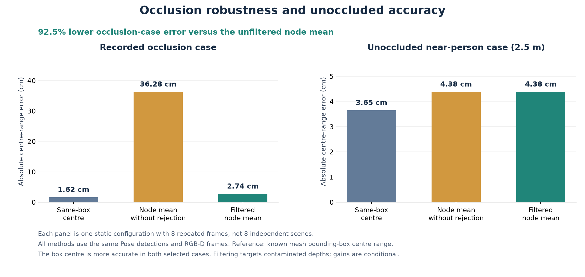
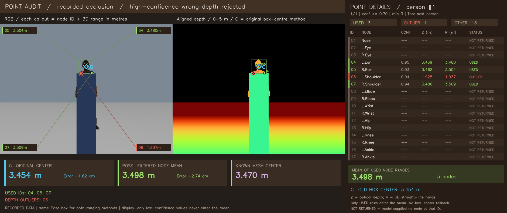
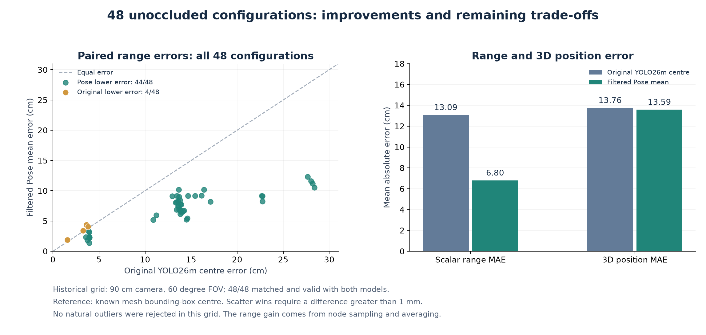
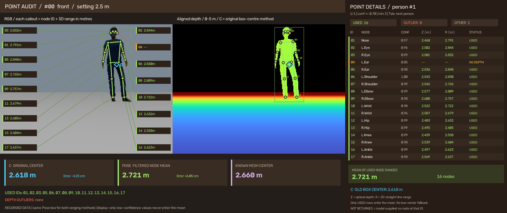
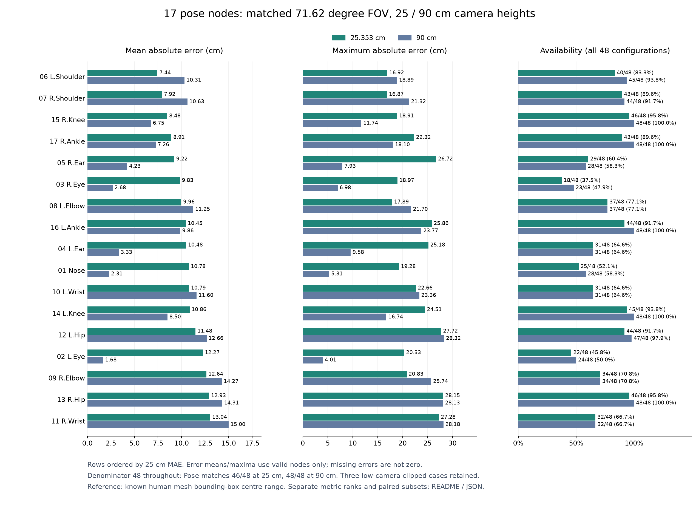
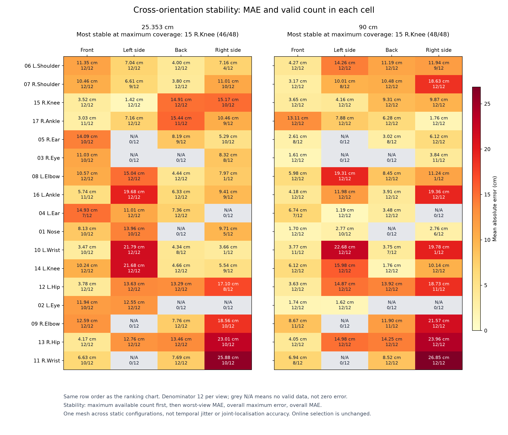
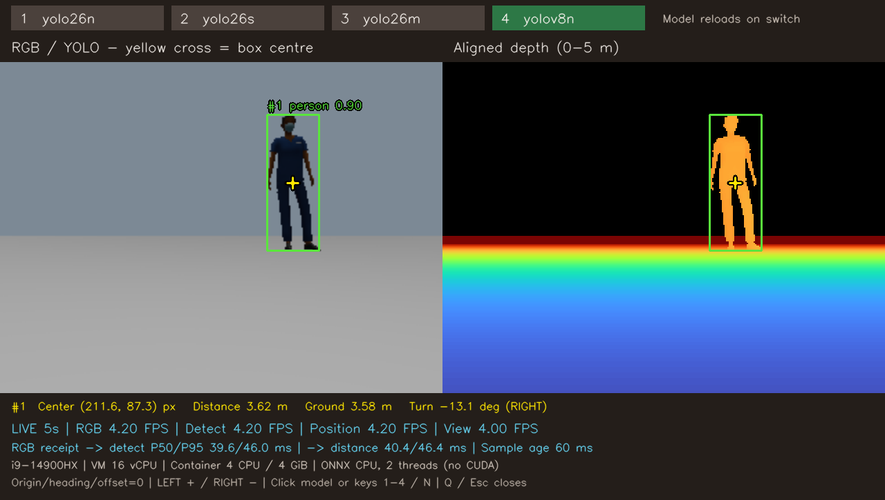
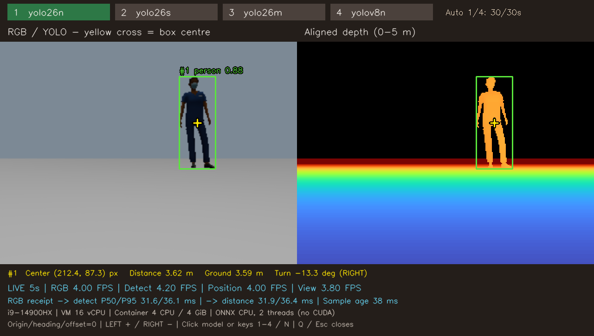
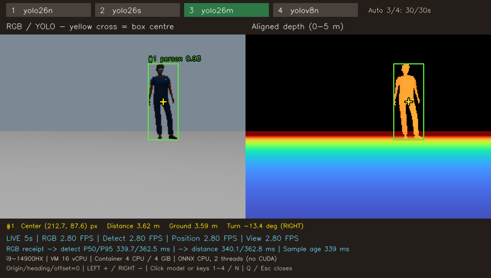

# TurtleBot 4 Person Detection and Following Research

Phases 1 and 2 provide technical research, an isolated simulation environment, sensor checks, and 2D person detection. Depth ranging supports the box-centre baseline and a YOLO26 Pose mode that averages high-confidence nodes after rejecting depth outliers, assuming the robot is at (0, 0, 0) with zero heading. All hardware is virtual. Real robot pose, camera mounting offsets, identity tracking and following are not integrated.

The original six-scene benchmark contains 360 frames and 322 visible person annotations. Recall was 78.26% overall, 100% for a nearby single person, 68.33% for crossing people, and 40.91% under occlusion. These are measurements of one synthetic human mesh, not evidence of reliable real-world following. See the [Phase 2 report](docs/phase2_detection.md).

## Integration status

Integration with commit [ece8c84](https://github.com/Intelligent-Robotics-project-group-7/Intelligent-Robotics-project-group-7/commit/ece8c84aa07ab65b9950223d08c630c2b4139b6f) is pending because of unresolved merge conflicts. That commit has not been merged into this branch; this version remains based on [23d4ef3](https://github.com/Intelligent-Robotics-project-group-7/Intelligent-Robotics-project-group-7/commit/23d4ef304fd5c5dd1f9569ccbeaa90554fce6038).

<!-- BEGIN POSE RESULTS GALLERY -->
## Pose-ranging results and limitations

**Depth-outlier rejection produced a large robustness improvement in the recorded occlusion case. Unoccluded accuracy is not guaranteed to improve, and the node mean can have a larger error than the box-centre baseline.** The comparison target matters: the large occlusion gain is relative to the unfiltered node mean, not a demonstrated gain over every other method.

| Recorded configuration | Same-Pose-box centre MAE | Node mean without rejection MAE | Filtered node mean MAE |
|---|---:|---:|---:|
| Partial occlusion | 1.62 cm | 36.28 cm | 2.74 cm |
| Unoccluded, person at 2.5 m | 3.65 cm | 4.38 cm | 4.38 cm |

In the occlusion configuration, one confident shoulder node samples the nearer obstacle. Rejecting that depth reduces the node-mean error by **92.5%**, from **36.28 to 2.74 cm**. The retained nodes are 04, 05 and 07; node 06 is rejected. This is one static occluder configuration repeated over eight frames, with a head-only detection associated using independent semantic-node labels. It demonstrates resistance to a wrong depth sample; it does not establish better occluded-person detection recall. The same-box centre remains more accurate in this example, at 1.62 cm.



The point audit below shows the actual recorded RGB, aligned depth and all returned node ranges. Green USED points enter the mean; the red OUTLIER point does not. Missing nodes receive no invented distance. The cyan C is the original centre sample.



For the unoccluded 2.5 m configuration, filtering rejects no points and the node mean has a **4.38 cm** error, compared with **3.65 cm** for the same-box centre. More accepted nodes do not necessarily give a better estimate of the person's centre: the nodes lie on different body surfaces, and their mean range is a different quantity from centre range.

In the separate historical **48-configuration unoccluded grid** (90 cm camera, 60-degree FOV), the original YOLO26m-centre pipeline has range MAE **13.09 cm**, versus **6.80 cm** for filtered Pose averaging. Nevertheless, the original has smaller absolute range error in **4/48** configurations by more than 1 mm. Mean 3D centre-proxy position error barely changes (**13.76 to 13.59 cm**), while mean absolute bearing error increases (**0.176 to 0.368 degrees**). All 48 configurations are matched and valid with both models. No natural depth outliers are rejected in this grid, so its average range improvement cannot be attributed to the outlier filter.



These are ideal simulated RGB-D measurements of one mesh. The common reference is the independently known visual mesh bounding-box centre, not true anatomical joints or physical-camera depth accuracy. Eight repeated frames of one scene remain one configuration; they are not eight independent occlusion trials. Median/MAD rejection also requires enough correct-depth samples: sparse or multiple contaminated samples can still defeat it. At least three nodes must survive, otherwise the output is invalid.

The current 25.353 cm and matched-optics 90 cm results, including all 17 node rankings and missed detections, are reported below. They use a different 71.62-degree FOV and remain separate from the historical grid above. Curated figures are included in this repository; development tests, replay scripts, raw depth arrays and diagnostic logs stay in the external development archive.
<!-- END POSE RESULTS GALLERY -->


## My work and the model speed/accuracy trade-off

This revision builds on the `robot-CV` YOLO26n baseline at commit [23d4ef3](https://github.com/Intelligent-Robotics-project-group-7/Intelligent-Robotics-project-group-7/commit/23d4ef304fd5c5dd1f9569ccbeaa90554fce6038), adding selectable models and person-centre distance and bearing outputs. The improvement figures in this section refer to that specific baseline version.

I tested YOLO26n, YOLO26s, YOLO26m and YOLOv8n through the same detection pipeline. On the same 360 synthetic frames containing 322 visible person annotations, recall increased from 78.26% with the `23d4ef3` baseline to 95.03% with YOLO26s or YOLO26m; YOLOv8n reached 93.17%. Compared with `23d4ef3`, the added model options improve measured detection coverage and allow a choice between accuracy and processing speed. The larger models required more processing time, and YOLO26s and YOLO26m achieved the same recall, so a larger model did not automatically improve every accuracy measure. These results describe this synthetic benchmark, rather than a demonstrated improvement on physical robots.

For my current accuracy-focused experiments, I have chosen YOLO26m, the largest model in the current set. This helps me investigate detection quality, but it may reduce the rate at which new person positions become available. The robot has a limited computing budget, so the final model choice needs to balance accuracy, processing speed and the resources needed by the rest of the system.

This trade-off matters especially when the person is moving. Even a correctly detected position can already be out of date when processing finishes. If inference or message queues fall behind, position updates may arrive too slowly to describe the person's current location. High accuracy on individual images therefore does not by itself establish good performance for person following.

I have added live FPS and receipt-latency counters to the preview so that I can switch models and observe their behaviour with a moving virtual person. The planning table below uses estimates; a complete four-model sustained live benchmark has not been completed for that table. My next step is to evaluate end-to-end latency, position update rate and observation age on the intended robot hardware. Delayed updates during real following remain a concern to test, rather than a failure already demonstrated on the physical robot.

## My computer and expected live performance

The development computer configuration was read locally on 11 November 2026:

| Component | Configuration |
|---|---|
| Host CPU | Intel Core i9-14900HX, 24 cores / 32 logical processors |
| Installed RAM | 32 GiB, two 16 GiB modules |
| Host GPU | NVIDIA GeForce RTX 4060 Laptop GPU, approximately 8 GiB VRAM (8188 MiB reported) |
| Host OS | Windows 11 Pro, build 26200 |
| Ubuntu VM | 16 logical vCPUs and 15946 MiB visible RAM (about 15.6 GiB) |
| Test container limit | 4 CPUs and 4 GiB RAM, shared by simulation, detection, ranging and preview |
| Model execution | ONNX Runtime CPU, 2 inference threads; no CUDA inference or GPU passthrough |
| Camera configuration | 320x240 RGB/depth, 5 frames per simulated second; software rendering |

The host has an RTX GPU, but this pipeline currently performs inference and simulation rendering on the CPU. These resource limits are part of the current development setup and do not describe the laptop's maximum available performance or the Raspberry Pi/OAK hardware on a physical robot.

### Estimated performance, not full benchmark results

The following are approximate planning ranges informed by earlier CPU replay results and brief/partial live checks. They are **estimates**, not a completed, controlled four-model live benchmark, confidence intervals or guaranteed limits. Actual rates and delays vary with rendering load, virtual-machine scheduling, scene complexity and other work on the computer.

| Model | Estimated detection update rate, wall-clock FPS | Estimated RGB-receipt-to-detection delay |
|---|---:|---:|
| YOLO26n | about 3.5-5 FPS | about 25-60 ms |
| YOLO26s | about 3-4.5 FPS | about 80-160 ms |
| YOLO26m | about 2-3.5 FPS | about 250-600 ms |
| YOLOv8n | about 3.5-5 FPS | about 35-80 ms |

FPS here means expected detection-result updates per real second in this simulated pipeline. It is not maximum model throughput and is not calculated as `1000 / latency_ms`. The configured 5 Hz camera rate uses simulation time; when rendering runs slower than real time, the actual input rate is lower. Rendering and inference also compete for the container's CPU allocation. Similar FPS values can therefore hide quite different per-frame processing delays.

The delay starts when the preview receives the RGB message and ends when it receives the detection for the same source timestamp. It excludes sensor acquisition, rendering and any transport before RGB reaches that subscriber. It is not pure neural-network inference time or a complete camera-to-robot-control latency.

### Interactive performance display

The local preview tools in `treerobot-CVothers` let me click the model buttons or press `1` to `4` to select YOLO26n, YOLO26s, YOLO26m or YOLOv8n. `N` selects the next model; `Q` or Esc closes the preview. Switching reloads the detector and clears old image/result caches before displaying the new model's data.

The screen shows **actual live measurements over a rolling five-second wall-clock window**, separately from the estimates above:

- **RGB FPS:** received RGB messages per second.
- **Detect FPS:** detection-array messages per second, including arrays with no person.
- **Position FPS:** frames per second with at least one valid distance point; it is not a persistent tracked-person rate.
- **View FPS:** new same-frame RGB/depth/detection/distance combinations handed to the preview per second.
- **P50/P95 latency:** same-source-timestamp RGB receipt to detection or distance-result receipt. Invalid callback-order pairs are counted separately and excluded from these latency percentiles.
- **Sample age:** time from RGB receipt to preparing that displayed sample, not the physical display's scan-out delay.

The virtual person moves repeatedly from side to side while the robot remains stationary. This helps make delayed updates visible, but it does not test real walking, identity tracking or autonomous following. Test scripts, raw performance records and preview code remain in `treerobot-CVothers`.

## Supported setup and prerequisites

- An x86_64 Ubuntu 24.04 or 26.04 Linux host/VM, an existing non-root account, and sudo access for host setup. ROS runs inside an Ubuntu 24.04 container. Native Windows/macOS, ARM, and physical cameras are outside the validated setup; on Windows, use an Ubuntu VM.
- Recommended host resources: 8 vCPUs, 8GB RAM, and at least 16GB free disk space before installation. Runtime containers use at most 4 CPUs and 4GiB RAM. Software rendering shares the CPU with inference and may run slower than real time.
- A working local Docker daemon and permission for your normal user to access it. The bootstrap below installs Ubuntu's Docker package if Docker is absent, preserves an existing Docker installation, and adds the selected account to the docker group. Docker-group membership grants administrator-equivalent host access.
- GitHub access to this repository. If HTTPS cloning requests authentication, configure your own Git credentials with repository access, or use the SSH URL with your registered key. Installation scripts do not contain or configure GitHub credentials.
- Internet access during installation to Docker Hub, Ubuntu/ROS apt repositories, GitHub and its release assets, Hugging Face, and Gazebo Fuel. No API keys are required for the public inputs. Runtime evaluation uses `--network none` and downloads nothing.
- Use a local Linux filesystem for the clone, with a writable checkout. Spaces in the directory name are supported; commas are rejected because of Docker bind-mount syntax. Run project scripts as your normal user, not with sudo.

No host ROS, CUDA, PyTorch, GPU, display server, or physical robot is required. Python tools and compilers used for perception run in the container; the bootstrap also installs host Git, Python 3, and CA certificates.

## Install from a fresh clone

Run in an Ubuntu terminal. Choose any clone location; scripts resolve the repository directory automatically.

```bash
# Only needed if Git is not already installed
sudo apt-get update
sudo apt-get install --no-install-recommends -y git ca-certificates

# Clone the requested branch into a directory you own
git clone --branch main --single-branch \
  https://github.com/Intelligent-Robotics-project-group-7/Intelligent-Robotics-project-group-7.git robot-cv
cd robot-cv/src/robotcv3

# One-time host setup; automatically selects the account invoking sudo
sudo bash scripts/bootstrap_host.sh
```

If your account uses SSH authentication, replace the clone URL above with `git@github.com:Intelligent-Robotics-project-group-7/Intelligent-Robotics-project-group-7.git` and keep `--branch main --single-branch`.

Log out and back in, or disconnect and reconnect SSH, to activate docker-group membership. Return to your clone directory, then confirm Docker access:

```bash
docker info
```

If running the bootstrap from a root shell rather than through your own sudo session, specify an existing non-root account explicitly: `bash scripts/bootstrap_host.sh --user ACCOUNT`. There is no fixed username, UID, or host project path.

Build the simulation image, download and checksum the model/assets, and compile the perception overlay:

```bash
bash scripts/install.sh
```

This runs `build_env.sh` followed by `setup_perception.sh`. Four ONNX detection models total approximately 143MB, the person asset approximately 1MB, and additional source/vendor dependencies are downloaded during compilation. The base image and apt packages account for most network and disk usage. Logs remain visible in the terminal; a successful install prints `Installation complete`.

The base image is pinned by digest in [Dockerfile](Dockerfile). The original Phase 1–2 assets and yolo_ros source commit are recorded in [the input lock](config/phase2_assets.lock.json). Additional model filenames and download URLs are in [config/person_models.json](config/person_models.json). ONNX Runtime is fixed to CPU version 1.20.0. The upstream CMake build fetches its vendor dependencies online, including huggingface-hub-cpp tag 1.1.5; the resolved commit is recorded in the generated provenance. apt repositories and upstream tags are not historical snapshots, so a later rebuild is not guaranteed to be byte-identical.

Large inputs and build products are generated locally in `downloads/` and `research_ws/` and are excluded from Git. Installation does not require any archive, model cache, or compiled workspace from the original server. The committed input lock is preserved; actual downloaded metadata is recorded in `downloads/phase2/assets.actual.json`.

## Verify installation and run Phases 1–2

```bash
bash scripts/verify_install.sh
```

This runs four scoring tests, the 45-second stationary RGB-D/lidar/TF check, all six person-detection scenes, HOG comparison, a 120-image ROS round-trip replay without rendering, and result/provenance generation. Allow several minutes after compilation. It stops at the first failed command and prints `PASS` only after the checks complete.

Inspect the generated results:

- `evidence/sensor_smoke.json`: `pass` must be true; includes received messages and sensor checks.
- `evidence/phase2/detection_report.json`: six scenes, frame counts, precision/recall, and conditional uncertainty. The baseline target is 60 paired frames per scene; simulated rendering can vary between runs.
- `evidence/phase2/offline_roundtrip.json`: replay timeouts must be zero; timing excludes sensor acquisition.
- `evidence/install_check.json`: final pass/fail, runtime UID/GID, case coverage, and image-hash verification summary.
- `evidence/phase2/detection_contact_sheet.png`: green predictions and blue independent ground-truth boxes.
- `evidence/phase2/provenance.json`: actual image, software, asset, and project provenance.

Rerunning tests replaces generated evidence in that checkout. Use a separate clone if you want to retain the committed historical measurements alongside new results. Installation success confirms the sensor/detection pipeline runs; it does not mean crossing/occlusion accuracy is sufficient for following.

Individual commands are also available:

```bash
# Stationary virtual sensor check only
bash scripts/run_env.sh bash scripts/run_smoke.sh

# Rebuild only perception, then run the complete scene suite and analysis
bash scripts/setup_perception.sh
bash scripts/run_person_suite.sh
bash scripts/analyze_person_suite.sh

# Optional interactive shell; the wrapper automatically detects a terminal
bash scripts/run_env.sh bash
```

All runtime wrappers use the caller's numeric UID/GID, a writable temporary home, a dynamically located host checkout, and the constant internal mount `/workspace`. They work without a TTY in SSH/CI. No physical devices are mapped; capabilities are dropped and resources are limited. Scene services move only synthetic person meshes; no robot velocity or navigation goals are sent.

## Select a detection model

Available models are **YOLO26n** (default), **YOLO26s**, **YOLO26m**, and **YOLOv8n**. Their filenames and download URLs are in [config/person_models.json](config/person_models.json). The model helper reuses existing nonempty files and downloads missing models; no model checksum configuration is required. The weights are community ONNX exports with AGPL-3.0 terms.

Existing installations can download the models without rebuilding or installing PyTorch:

```bash
python3 scripts/person_models.py list
bash scripts/setup_person_models.sh
```

For a manually prepared simulation, select the launch model with `model:=yolo26s` (or another registered ID). For an existing RGB topic, inside the ROS container use `bash scripts/run_person_detector.sh yolo26s`; start `person_detection_adapter.py` separately for the standard person-only output. Standalone detector selection does not start a camera, tracking, navigation, or robot motion.

## Person-centre distance and turn angle

`scripts/person_distance.py` reads the depth at the geometric centre of a YOLO person box and calculates the distance and bearing to that point. The detection launch file starts it automatically. This is the centre of the image rectangle, not the person's centre of mass or a fixed anatomical landmark.

For now, the robot is assumed to be at `(0, 0, 0)` with heading `0`. The camera is assumed to share that origin and face horizontally forward. Coordinates use `x` forward, `y` left and `z` up. Odometry, localisation, TF and the real camera mounting offset are not applied. The output frame is named `assumed_robot`; it is not a calibrated `base_link` or map frame.

### Temporary method and possible improvements

**Box-centre ranging is a temporary baseline, not the final target-point selection method.** It gives usable readings for the current upright synthetic person, but body proportions and pose can move the box midpoint away from the torso. A person with long legs, separated legs or an unusual pose may have a box centre that falls on an unsuitable body region, a gap between the legs or the background. Occlusion and a loose detection box can also make the centre pixel measure an obstacle or background surface instead of the intended person.

The detector has produced useful results in the tested scenes, but these use one human mesh and simple backgrounds. They do not establish that the detector or the selected depth point will remain reliable in clutter, crowds, strong occlusion, changing poses or camera motion. A correct person detection does not by itself guarantee a correct 3D target point. In particular, `valid=true` only means that the selected pixel has usable depth; it does not verify that the pixel belongs to the intended body region.

Two approaches to improving target selection are:

- **YOLO Pose keypoints and confidence scores.** The implemented experimental mode samples all sufficiently confident nodes, rejects depth outliers and averages the remaining node ranges. It does not restrict sampling to the torso. Keypoint confidence is a model score, not a guarantee of correct anatomy or depth. See the pose instructions below.
- **Depth-based shape or contour cues.** Depth discontinuities and nearby surface structure could help select body pixels inside the detected region and reject some background pixels. A depth image does not automatically provide a person-specific silhouette: nearby objects, similar depths, occlusion and missing depth can make the contour ambiguous. Whether these cues improve target selection in complex scenes is currently unknown.

Depth-guided regions remain a proposed direction. Pose-guided ranging now runs through the existing ONNX/ROS pipeline, but testing different body proportions, poses, clutter, motion and physical-camera noise is still needed. A coherent set of wrong foreground depths can survive the outlier filter; the filter assumes most selected depths belong to the person.

### Pose nodes, outlier rejection and mean distance

The optional `yolo26x-pose` and `yolo26n-pose` entries reuse existing local Ultralytics pose weights. They are not downloaded during the standard four-detector installation. In a Python environment with `ultralytics`, `torch` and `onnx`, export each required checkpoint:

```bash
python scripts/export_person_pose.py /path/to/yolo26x-pose.pt --model yolo26x-pose
python scripts/export_person_pose.py /path/to/yolo26n-pose.pt --model yolo26n-pose
```

The exporter copies the weights into ignored `downloads/phase2/models`, preserves the originals, and writes ONNX output and a SHA-256 receipt. Export uses raw pose output `[1, 56, 8400]`, 640×640 input and opset 17 for the pinned C++ Pose decoder. PyTorch is needed for export, not for the ROS runtime.

With the simulation assets prepared and the ROS/perception overlay sourced in the same container:

```bash
ros2 launch /workspace/launch/person_detection_eval.launch.py \
  case:=single_front model:=yolo26x-pose \
  keypoint_threshold:=0.7 minimum_keypoints:=3 \
  outlier_tolerance_m:=0.5 outlier_mad_scale:=3.0
```

For each person independently, the distance node reads `/perception/people/poses2d` and exactly timestamp-matched aligned depth and camera intrinsics. It retains nodes with confidence ≥0.7, in-image coordinates and finite positive depth. It computes the median optical depth and median absolute deviation (MAD), then rejects nodes whose depth differs from the median by more than `max(0.5 m, 3 × 1.4826 × MAD)`. The 0.5 m tolerance and MAD multiplier are configurable. At least three nodes must remain; otherwise the result is invalid, with no box-centre fallback.

In pose mode, `depth_m` is the arithmetic mean of retained optical depths; `distance_m` is the arithmetic mean of retained 3D node ranges; `ground_distance_m` is the mean horizontal node range. `position_m` and `/perception/people/center_poses` contain the nodes' 3D centroid, and the bearing points towards that centroid. `centroid_distance_m` is its range, which can differ from the mean node range. These are camera-relative quantities under the existing origin assumptions, not anatomical centre-of-mass measurements.

JSON output includes `method`, `sample_count`, `candidate_count`, `rejected_count`, the accepted `samples`, and `rejected_samples` with pixel, node ID, confidence, depth and rejection reason. COCO node IDs follow the pinned ROS decoder's 1–17 numbering. The external preview displays USED nodes in green and rejected depth samples as red crosses, with per-node confidence/depth/range/status tables. Its pose mode switches between x and n; the original detector mode keeps the four box-detector choices. Local test scripts and accuracy reports remain in the sibling `treerobot-CVothers` directory.

### Body-part-neutral node averaging

The experimental eye/head-first anatomical preference has been removed at the user's request. There is no head/torso/limb priority or launch control for it. All nodes that pass the original confidence, aligned-depth, global outlier and minimum-count checks contribute equally. Qualified eye/head nodes can still contribute normally; they receive no preference. `selection_policy=all_valid` remains as a compatibility value in the data interface; the retired value is rejected explicitly.

The source and measurements of the removed experiment are retained only in the external test archive. Camera-height experiments, including a rig matching the robot's nominal approximately 25 cm mount and a matched-optics 90 cm control, are reported below; raw records remain in the external development archive. The existing robot simulation and depth-unit/coordinate conventions are preserved.

At the nominal 25.353 cm camera height and robot-matched 1.25 rad horizontal FOV, the 48-configuration test produced 46 valid Pose outputs. On these same outputs, equal-weight averaging had slant-range MAE / maximum error of **6.35 / 16.27 cm**, compared with **10.91 / 23.17 cm** for the removed head preference evaluated offline. The other two configurations were Pose misses and remain in the availability denominator (46/48). The independent reference is the known mesh bounding-box centre; this is a calibrated synthetic camera-rig test, not physical-camera validation or measured settled robot geometry. The external report retains image-edge cases, fully-visible and paired subsets, horizontal/3D errors, the old centre baseline and English figures.

<!-- BEGIN LOW CAMERA AUDIT -->
The following recorded low-camera frame labels each returned node with its range and adoption status. This is one point audit, separate from the all-48 statistics. The table distinguishes optical depth Z from 3D range R; the cyan C gives the same-Pose-box centre baseline.


<!-- END LOW CAMERA AUDIT -->

<!-- BEGIN HEIGHT NODE DETAIL -->
### Per-node comparison at 25.353 cm and 90 cm (matched optics)

**Summary:** Under the explicit availability-first rule, right knee 15 ranks first at both heights. At 25 cm its MAE / maximum error is 8.48 / 18.91 cm with 46/48 valid outputs; at 90 cm it is 6.75 / 11.74 cm with 48/48. Left shoulder 06 has the smallest low-camera conditional MAE (7.44 cm), but only 40/48 valid readings and 4/12 in the right-side view. Left eye 02 falls from MAE rank 1 at 90 cm to rank 14 at 25 cm. Its same 22 fully-visible paired configurations give low/high MAE 12.27 / 1.67 cm. The knee does not win every error metric; the active all-qualified-node mean is retained. Full statistics and trade-offs follow.

This is the current height comparison. Both completed 48-configuration runs use **1.25 rad / 71.62-degree FOV** with identical camera x/y, image dimensions, clipping planes, mesh poses and YOLO26x-pose weights. The older 90 cm / 60-degree ranking remains a separate historical section in the external tools README and is not the matched control. No new inference or online tuning is performed. All **96 frozen RGB-D hashes** are verified; all 94 matched Pose outputs are recomputed with the active neutral averaging helper and checked field by field against the saved results. Saved per-point annotations, where present, are also cross-checked.

Archived source runs: `unoccluded_comparison_20261112T002305Z_0saYMJ` (25.353 cm) and `unoccluded_comparison_20261112T002515Z_xO9DM2` (90 cm). Each is four distances (2.5/3.5/4.5/5.5 m) x three lateral offsets (-0.6/0/+0.6 m) x four views (front/left/back/right). Nominal camera positions are (-0.0596,0,0.25353) and (-0.0596,0,0.9) m, with 320x240 images and near0.3/far100 m.

**Definitions:** node error is the absolute difference between its 3D slant range and the known mesh bounding-box centre range. A valid node must be retained on a matched valid person output after the unchanged confidence >=0.7, positive finite aligned depth, global median/MAD and three-node minimum checks. Every node uses denominator **48**, or **12 per view**, including missed detections and rejected/missing nodes. Missing errors are null, never zero. Means and maxima use available readings only; the different node subsets must be interpreted alongside coverage. Left/right mean the person's left/right. These are body-centre range proxy errors, not anatomical joint localisation errors.

**Separate rankings:** the tables show all 17 nodes ordered by mean error, with independent maximum-error rank and tied availability rank. JSON also stores each complete sorted ranking. An all-direction stability candidate must have the maximum observed valid count and readings in all four views; candidates are ordered by worst-orientation MAE, then overall maximum error, overall MAE and ID. This extends the previous all-48 criterion explicitly because no node can survive the two low-camera detector misses. It does not call 46/48 always available.

#### 25.353 cm: all 48 configurations

| MAE rank | Node | MAE (cm) | Maximum (cm) | Max-error rank | Valid / 48 | Valid rate | Availability rank (ties) |
|---:|---|---:|---:|---:|---:|---:|---:|
| 1 | 06 L.Shoulder | 7.44 | 16.92 | 2 | 40/48 | 83.3% | 5 |
| 2 | 07 R.Shoulder | 7.92 | 16.87 | 1 | 43/48 | 89.6% | 4 |
| 3 | 15 R.Knee | 8.48 | 18.91 | 4 | 46/48 | 95.8% | 1 |
| 4 | 17 R.Ankle | 8.91 | 22.32 | 9 | 43/48 | 89.6% | 4 |
| 5 | 05 R.Ear | 9.22 | 26.72 | 14 | 29/48 | 60.4% | 10 |
| 6 | 03 R.Eye | 9.83 | 18.97 | 5 | 18/48 | 37.5% | 13 |
| 7 | 08 L.Elbow | 9.96 | 17.89 | 3 | 37/48 | 77.1% | 6 |
| 8 | 16 L.Ankle | 10.45 | 25.86 | 13 | 44/48 | 91.7% | 3 |
| 9 | 04 L.Ear | 10.48 | 25.18 | 12 | 31/48 | 64.6% | 9 |
| 10 | 01 Nose | 10.78 | 19.28 | 6 | 25/48 | 52.1% | 11 |
| 11 | 10 L.Wrist | 10.79 | 22.66 | 10 | 31/48 | 64.6% | 9 |
| 12 | 14 L.Knee | 10.86 | 24.51 | 11 | 45/48 | 93.8% | 2 |
| 13 | 12 L.Hip | 11.48 | 27.72 | 16 | 44/48 | 91.7% | 3 |
| 14 | 02 L.Eye | 12.27 | 20.33 | 7 | 22/48 | 45.8% | 12 |
| 15 | 09 R.Elbow | 12.64 | 20.83 | 8 | 34/48 | 70.8% | 7 |
| 16 | 13 R.Hip | 12.93 | 28.15 | 17 | 46/48 | 95.8% | 1 |
| 17 | 11 R.Wrist | 13.04 | 27.28 | 15 | 32/48 | 66.7% | 8 |

Smallest conditional MAE: **06 L.Shoulder**, 7.44 cm on 40/48 readings. Under the stated coverage-first criterion, the most stable candidate is **15 R.Knee**: 46/48, MAE **8.48 cm**, maximum **18.91 cm**, worst-view MAE **15.17 cm**.

| Stability rank (maximum coverage only) | Node | Valid / 48 | MAE (cm) | Maximum (cm) | Worst-view MAE (cm) |
|---:|---|---:|---:|---:|---:|
| 1 | 15 R.Knee | 46/48 | 8.48 | 18.91 | 15.17 |
| 2 | 13 R.Hip | 46/48 | 12.93 | 28.15 | 23.01 |

Orientation cells below are **MAE in cm [valid/12]**. JSON additionally gives maximum error, P95, bias and missing-status counts for every node/view.

| Node | Front | Left side | Back | Right side |
|---|---:|---:|---:|---:|
| 06 L.Shoulder | 11.35 [12/12] | 7.04 [12/12] | 4.00 [12/12] | 7.16 [4/12] |
| 07 R.Shoulder | 10.46 [12/12] | 6.61 [9/12] | 3.80 [12/12] | 11.01 [10/12] |
| 15 R.Knee | 3.52 [12/12] | 1.42 [12/12] | 14.91 [12/12] | 15.17 [10/12] |
| 17 R.Ankle | 3.03 [11/12] | 7.16 [12/12] | 15.44 [11/12] | 10.46 [9/12] |
| 05 R.Ear | 14.09 [10/12] | N/A [0/12] | 8.19 [9/12] | 5.29 [10/12] |
| 03 R.Eye | 11.03 [10/12] | N/A [0/12] | N/A [0/12] | 8.32 [8/12] |
| 08 L.Elbow | 10.57 [12/12] | 15.04 [12/12] | 4.44 [12/12] | 7.97 [1/12] |
| 16 L.Ankle | 5.74 [11/12] | 19.68 [12/12] | 6.33 [12/12] | 9.41 [9/12] |
| 04 L.Ear | 14.93 [7/12] | 11.01 [12/12] | 7.36 [12/12] | N/A [0/12] |
| 01 Nose | 8.13 [10/12] | 13.96 [10/12] | N/A [0/12] | 9.71 [5/12] |
| 10 L.Wrist | 3.47 [10/12] | 21.79 [12/12] | 4.34 [8/12] | 3.66 [1/12] |
| 14 L.Knee | 10.24 [12/12] | 21.68 [12/12] | 4.66 [12/12] | 5.54 [9/12] |
| 12 L.Hip | 3.78 [12/12] | 13.63 [12/12] | 13.29 [12/12] | 17.10 [8/12] |
| 02 L.Eye | 11.94 [10/12] | 12.55 [12/12] | N/A [0/12] | N/A [0/12] |
| 09 R.Elbow | 12.59 [12/12] | N/A [0/12] | 7.76 [12/12] | 18.56 [10/12] |
| 13 R.Hip | 4.17 [12/12] | 12.76 [12/12] | 13.46 [12/12] | 23.01 [10/12] |
| 11 R.Wrist | 6.63 [10/12] | N/A [0/12] | 7.69 [12/12] | 25.88 [10/12] |

#### 90 cm: all 48 configurations

| MAE rank | Node | MAE (cm) | Maximum (cm) | Max-error rank | Valid / 48 | Valid rate | Availability rank (ties) |
|---:|---|---:|---:|---:|---:|---:|---:|
| 1 | 02 L.Eye | 1.68 | 4.01 | 1 | 24/48 | 50.0% | 10 |
| 2 | 01 Nose | 2.31 | 5.31 | 2 | 28/48 | 58.3% | 9 |
| 3 | 03 R.Eye | 2.68 | 6.98 | 3 | 23/48 | 47.9% | 11 |
| 4 | 04 L.Ear | 3.33 | 9.58 | 5 | 31/48 | 64.6% | 8 |
| 5 | 05 R.Ear | 4.23 | 7.93 | 4 | 28/48 | 58.3% | 9 |
| 6 | 15 R.Knee | 6.75 | 11.74 | 6 | 48/48 | 100.0% | 1 |
| 7 | 17 R.Ankle | 7.26 | 18.10 | 8 | 48/48 | 100.0% | 1 |
| 8 | 14 L.Knee | 8.50 | 16.74 | 7 | 48/48 | 100.0% | 1 |
| 9 | 16 L.Ankle | 9.86 | 23.77 | 13 | 48/48 | 100.0% | 1 |
| 10 | 06 L.Shoulder | 10.31 | 18.89 | 9 | 45/48 | 93.8% | 3 |
| 11 | 07 R.Shoulder | 10.63 | 21.32 | 10 | 44/48 | 91.7% | 4 |
| 12 | 08 L.Elbow | 11.25 | 21.70 | 11 | 37/48 | 77.1% | 5 |
| 13 | 10 L.Wrist | 11.60 | 23.36 | 12 | 31/48 | 64.6% | 8 |
| 14 | 12 L.Hip | 12.66 | 28.32 | 17 | 47/48 | 97.9% | 2 |
| 15 | 09 R.Elbow | 14.27 | 25.74 | 14 | 34/48 | 70.8% | 6 |
| 16 | 13 R.Hip | 14.31 | 28.13 | 15 | 48/48 | 100.0% | 1 |
| 17 | 11 R.Wrist | 15.00 | 28.18 | 16 | 32/48 | 66.7% | 7 |

Smallest conditional MAE: **02 L.Eye**, 1.68 cm on 24/48 readings. Under the stated coverage-first criterion, the most stable candidate is **15 R.Knee**: 48/48, MAE **6.75 cm**, maximum **11.74 cm**, worst-view MAE **9.87 cm**.

| Stability rank (maximum coverage only) | Node | Valid / 48 | MAE (cm) | Maximum (cm) | Worst-view MAE (cm) |
|---:|---|---:|---:|---:|---:|
| 1 | 15 R.Knee | 48/48 | 6.75 | 11.74 | 9.87 |
| 2 | 17 R.Ankle | 48/48 | 7.26 | 18.10 | 13.11 |
| 3 | 14 L.Knee | 48/48 | 8.50 | 16.74 | 15.98 |
| 4 | 16 L.Ankle | 48/48 | 9.86 | 23.77 | 19.36 |
| 5 | 13 R.Hip | 48/48 | 14.31 | 28.13 | 23.96 |

Orientation cells below are **MAE in cm [valid/12]**. JSON additionally gives maximum error, P95, bias and missing-status counts for every node/view.

| Node | Front | Left side | Back | Right side |
|---|---:|---:|---:|---:|
| 02 L.Eye | 1.74 [12/12] | 1.62 [12/12] | N/A [0/12] | N/A [0/12] |
| 01 Nose | 1.70 [12/12] | 2.77 [10/12] | N/A [0/12] | 2.76 [6/12] |
| 03 R.Eye | 1.61 [12/12] | N/A [0/12] | N/A [0/12] | 3.84 [11/12] |
| 04 L.Ear | 6.74 [7/12] | 1.19 [12/12] | 3.48 [12/12] | N/A [0/12] |
| 05 R.Ear | 2.61 [8/12] | N/A [0/12] | 3.02 [8/12] | 6.12 [12/12] |
| 15 R.Knee | 3.65 [12/12] | 4.16 [12/12] | 9.31 [12/12] | 9.87 [12/12] |
| 17 R.Ankle | 13.11 [12/12] | 7.88 [12/12] | 6.28 [12/12] | 1.76 [12/12] |
| 14 L.Knee | 6.12 [12/12] | 15.98 [12/12] | 1.76 [12/12] | 10.14 [12/12] |
| 16 L.Ankle | 4.18 [12/12] | 11.98 [12/12] | 3.91 [12/12] | 19.36 [12/12] |
| 06 L.Shoulder | 4.27 [12/12] | 14.26 [12/12] | 11.19 [12/12] | 11.94 [9/12] |
| 07 R.Shoulder | 3.17 [12/12] | 10.01 [8/12] | 10.48 [12/12] | 18.63 [12/12] |
| 08 L.Elbow | 5.98 [12/12] | 19.31 [12/12] | 8.45 [12/12] | 11.24 [1/12] |
| 10 L.Wrist | 3.77 [11/12] | 22.68 [12/12] | 3.75 [7/12] | 19.78 [1/12] |
| 12 L.Hip | 3.63 [12/12] | 14.87 [12/12] | 13.92 [12/12] | 18.73 [11/12] |
| 09 R.Elbow | 8.67 [11/12] | N/A [0/12] | 11.90 [11/12] | 21.57 [12/12] |
| 13 R.Hip | 4.05 [12/12] | 14.98 [12/12] | 14.25 [12/12] | 23.96 [12/12] |
| 11 R.Wrist | 6.94 [8/12] | N/A [0/12] | 8.52 [12/12] | 26.85 [12/12] |

#### Same-node, same-configuration height comparisons

The following pairs retain only configurations where that **same node** is valid at both heights. Each row uses its own paired subset; rows are not equal-coverage candidates. All-case tables above retain the 48-case availability denominator. Positive change means the low camera has larger MAE.

| Node | Paired valid cases | 25 cm MAE (cm) | 90 cm MAE (cm) | Low minus high (cm) | Strict fully-visible paired cases | Strict low / high MAE (cm) |
|---|---:|---:|---:|---:|---:|---:|
| 01 Nose | 22 | 10.98 | 2.20 | 8.78 | 21 | 10.92 / 2.24 |
| 02 L.Eye | 22 | 12.27 | 1.67 | 10.60 | 22 | 12.27 / 1.67 |
| 03 R.Eye | 18 | 9.83 | 2.36 | 7.47 | 15 | 8.95 / 2.56 |
| 04 L.Ear | 30 | 10.46 | 3.23 | 7.23 | 27 | 10.02 / 3.46 |
| 05 R.Ear | 25 | 8.24 | 4.02 | 4.22 | 20 | 7.21 / 4.24 |
| 06 L.Shoulder | 40 | 7.44 | 9.88 | -2.45 | 35 | 7.93 / 9.87 |
| 07 R.Shoulder | 40 | 8.04 | 10.09 | -2.05 | 34 | 8.52 / 9.46 |
| 08 L.Elbow | 37 | 9.96 | 11.25 | -1.28 | 33 | 10.62 / 11.53 |
| 09 R.Elbow | 32 | 12.74 | 13.72 | -0.97 | 26 | 13.05 / 12.90 |
| 10 L.Wrist | 29 | 11.19 | 12.21 | -1.02 | 25 | 12.42 / 12.85 |
| 11 R.Wrist | 30 | 13.55 | 14.20 | -0.65 | 24 | 12.92 / 13.45 |
| 12 L.Hip | 44 | 11.48 | 11.95 | -0.47 | 38 | 11.02 / 11.46 |
| 13 R.Hip | 46 | 12.93 | 13.96 | -1.03 | 40 | 12.33 / 13.21 |
| 14 L.Knee | 45 | 10.86 | 8.37 | 2.49 | 39 | 11.84 / 8.68 |
| 15 R.Knee | 46 | 8.48 | 6.58 | 1.90 | 40 | 7.25 / 6.22 |
| 16 L.Ankle | 44 | 10.45 | 9.21 | 1.24 | 38 | 10.78 / 8.75 |
| 17 R.Ankle | 43 | 8.91 | 7.49 | 1.43 | 37 | 8.00 / 8.29 |

**What changes with height:**

- Left eye 02 changes from MAE rank 1 at 90 cm to rank 14 at 25 cm. Even on its same 22 valid configurations, low/high MAE is **12.27 / 1.67 cm**. These 22 pairs are fully visible at both heights, so this difference is not explained by the three low-camera clipped cases.
- Left shoulder 06 has the smallest low-camera conditional MAE, but its right-side availability is only 4/12. On its same 40 paired valid configurations, low/high MAE is 7.44 / 9.88 cm. Right shoulder 07 trades slightly larger low-camera MAE (7.92 cm) for more readings (43/48); it also has smaller worst-view error than the right knee, but lower availability. Thus the knee does not dominate every metric.
- Right knee 15 wins the **maximum-coverage candidate** comparison at both heights. On the same 46 valid configurations its low/high MAE is 8.48 / 6.58 cm. On the same 40 fully-visible pairs it is 7.25 / 6.22 cm; the low-camera knee remains worse after removing image-edge cases. The low-camera fully-visible ranking still chooses node 15 among maximum-coverage candidates (40/42 valid).
- A fixed-node winner under this retrospective rule is not evidence to replace the active multi-node mean: its mean slant-range error was 6.35 cm at 25 cm, below the right knee's 8.48 cm, on the same 46 valid outputs. No single node simultaneously gives the lowest error and highest availability.


Low-camera configurations 27 and 35 are fully-visible right-side Pose misses; all 17 nodes receive NO PERSON MATCH on those cases. Three other configurations are image-clipped and three more lack the strict three-pixel border margin. They stay in all48. The fully-visible subset has 42 configurations at 25 cm and 48 at 90 cm; JSON includes a complete ranking for each such subset, plus per-node paired fully-visible comparisons. No image-edge case is silently discarded.

The point with the smallest available-frame MAE can have low availability, missing orientations, or large tail errors. The stability rule is explicit and does not combine centimetres with percentages into an arbitrary score. This is cross-orientation consistency over one frame per configuration, not temporal jitter. Results are exploratory for one mesh and nominal ideal camera rigs, with no settled chassis, held-out subjects or physical-camera validation. Rankings do not restore eye/head priority or replace the current all-qualified-node mean.

The 96 frozen RGB-D files and 94 matched Pose outputs were verified. Six focused ranking/pairing tests passed; an independent audit checked 170 node/view statistic groups. Raw records and development scripts are retained outside this repository. All 17-node results needed to interpret these figures are in the tables above.




<!-- END HEIGHT NODE DETAIL -->

### Inputs and calculation

The node subscribes to three messages with the same source timestamp:

| Input topic | Purpose |
|---|---|
| `/perception/people/detections2d` | Person-box centre pixel `(u, v)` |
| `/oakd/rgb/preview/depth` | Depth at the centre pixel |
| `/oakd/rgb/preview/camera_info` | Camera intrinsics `fx, fy, cx, cy` |

RGB and depth must be aligned and have matching dimensions. The current implementation requires rectified images. Exact timestamp matching prevents an old box from being combined with a newer depth image. `32FC1` depth is read in metres; `16UC1` depth is read in millimetres and converted to metres. See [ROS REP-118](https://reps.openrobotics.org/rep-0118/) for the depth-unit convention.

The calculation below uses the depth `D` from the nearest integer pixel to the box centre. The floating-point box centre is used to calculate the viewing direction:

```text
u = (left + right) / 2
v = (top + bottom) / 2

x = D
y = -(u - cx) * D / fx
z = -(v - cy) * D / fy

distance_m        = sqrt(x*x + y*y + z*z)
ground_distance_m = sqrt(x*x + y*y)
turn_yaw_rad      = atan2(y, x)
turn_yaw_deg      = turn_yaw_rad * 180 / pi
```

This converts optical coordinates into forward/left/up coordinates, following the axis convention in [ROS REP-103](https://www.ros.org/reps/rep-0103.html). `depth_m` is depth along the camera's forward optical axis. For an off-centre point, it differs from the straight-line distance `distance_m`.

### Output fields

`/perception/people/distances` uses `std_msgs/msg/String` containing JSON. Each entry in `people` describes one detection:

| Field | Meaning |
|---|---|
| `stamp` | Source image timestamp |
| `robot_position_m`, `robot_yaw_rad` | Current placeholder origin and zero heading |
| `detection_index` | Index in this frame's detection list, not a persistent person ID |
| `center_px`, `sample_pixel` | Floating-point box centre and sampled integer depth pixel |
| `valid` | Whether usable depth was obtained at the selected centre pixel |
| `position_m` | `x, y, z` in the assumed robot frame, in metres |
| `distance_m` | 3D straight-line distance from the origin to the sampled surface point, in metres |
| `ground_distance_m` | Distance projected onto the horizontal plane, in metres |
| `turn_yaw_rad`, `turn_yaw_deg` | Left/right bearing towards the point, in radians and degrees |
| `reason` | Reason for an invalid measurement; present when `valid=false` |

Positive turn angles mean left, negative angles mean right and zero means straight ahead. This is the target point's relative bearing, not a measured robot rotation or angular velocity. Real robot position, heading and camera mounting transforms will be added later.

The following is an actual output from a virtual single-person scene, with values rounded:

```json
{
  "robot_position_m": {"x": 0.0, "y": 0.0, "z": 0.0},
  "robot_yaw_rad": 0.0,
  "people": [{
    "detection_index": 0,
    "valid": true,
    "center_px": {"u": 210.44, "v": 81.39},
    "sample_pixel": {"u": 210, "v": 81},
    "depth_m": 3.4798,
    "position_m": {"x": 3.4798, "y": -0.7914, "z": 0.6058},
    "distance_m": 3.6197,
    "ground_distance_m": 3.5686,
    "turn_yaw_rad": -0.2236,
    "turn_yaw_deg": -12.8127
  }]
}
```

The point is ahead and to the right, at a horizontal distance of about 3.57 metres and a rightward bearing of about 12.81 degrees. The single-person run produced 127 valid readings. This verifies the simulated data path, not physical ranging accuracy or reliable anatomical target selection.

`/perception/people/center_poses` provides the same valid points as a standard `geometry_msgs/msg/PoseArray`. Position matches `position_m`. Each quaternion represents the yaw towards the point, not the person's own facing direction.

### Start and read the data

From the Ubuntu project directory, enter the container and run the remaining commands in that same container terminal:

```bash
bash scripts/run_env.sh bash
source /opt/ros/jazzy/setup.bash
source /workspace/research_ws/install/setup.bash
python3 scripts/prepare_person_world.py single_front
xvfb-run -a ros2 launch /workspace/launch/person_detection_eval.launch.py \
  case:=single_front model:=yolov8n > /tmp/person_detection.log 2>&1 &
ros2 topic echo /perception/people/distances
```

Each invocation of `run_env.sh` creates a separate network-isolated container, so start the nodes and read their output in the same container. Press Ctrl+C to stop reading. Exiting the container ends that run.

A ROS Python subscriber can read the values as follows:

```python
import json
import rclpy
from rclpy.node import Node
from std_msgs.msg import String

def receive(msg):
    data = json.loads(msg.data)
    for person in data['people']:
        if person['valid']:
            distance = person['ground_distance_m']
            angle = person['turn_yaw_deg']
            print(f'Ground distance {distance:.2f} m, turn angle {angle:.1f} deg')

rclpy.init()
node = Node('read_person_distance')
subscription = node.create_subscription(String, '/perception/people/distances', receive, 10)
rclpy.spin(node)
```

Check `valid` before reading distance values. Zero, NaN or infinite centre depth, or a centre outside the image, produces an invalid reading without a distance value; failure is not reported as zero metres. A frame without people has `people=[]`. These checks reject unusable measurements but cannot identify every semantically wrong surface point.

If a complete set of same-timestamp inputs is unavailable, the node publishes no new distance. Consumers should check reception time and discard stale data, for example after 0.5 seconds without an update. `stamp` uses simulation time; do not subtract it directly from UTC time to decide whether data is stale. In a multi-person scene, target selection is a separate task: the first array entry is not a permanently locked person.

The current output is for inspecting distance and bearing data. It sends no base velocities or navigation commands, and the temporary centre-point method should not be treated as a finished person-following solution.

## Rebuild and troubleshooting

```bash
# Rebuild without application-layer cache and refresh the pinned base manifest
bash scripts/install.sh --no-cache --pull

# Optional: use a separate image tag for an independent checkout
export TB4_IMAGE=turtlebot4-research:my-test
bash scripts/install.sh
bash scripts/verify_install.sh
```

- **Docker unavailable/permission denied:** finish the host bootstrap, reconnect your session, and retry `docker info` without sudo. If Docker is installed but the daemon is stopped, start it with `sudo systemctl start docker` on a systemd host.
- **Download or registry failure:** check the installation endpoints listed above and retry installation. Asset downloads use temporary files and retries; cached immutable files are checked against committed hashes. A hash mismatch is an error: do not disable verification. Remove only the named corrupt input from your own clone before retrying.
- **Overlay missing:** run `bash scripts/setup_perception.sh` and inspect the compiler output before starting evaluation. All five upstream packages must build successfully.
- **Insufficient disk/memory or slow rendering:** inspect `df -h`, `free -h`, and Docker resource usage, then allocate the recommended VM resources. Do not interpret simulation-time FPS as wall-clock performance. Case-specific logs are in `evidence/phase2/CASE/simulation.log` and `evidence/phase2/CASE_console.log`.
- **Switching directories after compiling:** CMake/colcon outputs may contain absolute paths. Clone/build in the intended location; rebuild the overlay after moving it. Keep the same `TB4_IMAGE` for installation and execution.

## Reports and evidence

- [Clean installation validation](docs/installation_validation.md)
- [Phase 2 detection results, limitations, and reproduction](docs/phase2_detection.md)
- [Industry research and nine open-source projects](docs/industry_research.md)
- [Technology comparison and selection](docs/technology_comparison.md)
- [Proposed system architecture](docs/system_architecture.md)
- [Virtual hardware and resource assessment](docs/hardware_assessment.md)
- [Phased implementation plan and proposed acceptance criteria](docs/implementation_plan.md)
- [Original executed checks and test records](docs/test_report.md)



YOLOv8n preview with the selected model highlighted and live person-centre measurements.



YOLO26n baseline preview, showing the same distance and bearing outputs with live performance counters.



YOLO26m preview, showing the larger model's live update rate and receipt latency in the moving-person scene.

These are actual preview snapshots with rolling five-second measurements, captured at different moments. Their displayed values are separate from the estimated performance ranges above and do not form a controlled same-frame model comparison. The YOLO26n and YOLO26m images were saved during a partial timed run; the full four-model timed comparison was not completed. The original detection contact sheet remains in `evidence/phase2/detection_contact_sheet.png`.

Person mesh: OpenRobotics Scrubs, CC BY 4.0; attribution and limitations are in the Phase 2 report. Physical OAK depth accuracy, VPU performance, calibrated robot-frame localisation, identity tracking, navigation, and autonomous following remain **NOT VERIFIED**.
